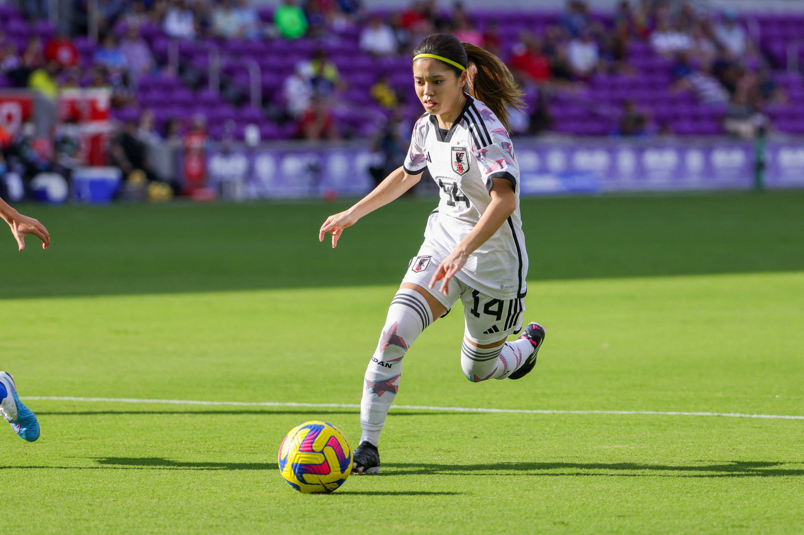

---
diagram:
  mermaid:
    theme: dark
format:
  revealjs:
    theme: [default, custom.scss]
    background-color: "#1e3a5f"
    slide-number: false
    controls: true
    progress: false
    transition: fade
    width: 1400
    height: 787
---

## {background-image="photos/dolores.jpeg" background-size="cover" background-opacity="0.7"}

::: {style="position: absolute; top: 8%; left: 5%;"}
[STAT 5 SP 2026]{.teal style="font-size: 0.65em; letter-spacing: 0.2em; text-transform: uppercase; display: block; margin-bottom: 0.4em;"}

[WELCOME TO SECTION!]{style="font-size: 2.2em; font-weight: 300; letter-spacing: 0.08em; color: white;"}
:::

---

## Agenda

:::: {.columns}
::: {.column width="55%"}
- Introductions
- Contact & Logistics
- How to Get Better at Stats
- Week 1 Review
- Attendance Quiz
- Google Sheets Basics
- Worksheet 1
:::
::: {.column width="45%"}
{style="border-radius: 8px; width: 100%; max-height: 480px; object-fit: cover;"}
:::
::::

---

## Intro: Get to Know Each Other

<br>

1. How do you feel about statistics and taking this class? Excited? Nervous? You can be honest.

2. What's something you've been into lately?

3. Favorite ice cream flavor?

---

## Intro: About Me {background-color="#1e3a5f"}

:::: {.columns}
::: {.column width="55%"}
- **Name:** Sho Kawano
- **From:** Tokyo, Japan
- **Grew up in:** Honolulu, HI & Sacramento, CA
- **Stats Ph.D Student**
- **Stuff I like:** Travel & Meditation
:::
::: {.column width="45%"}
**Add an optional course-specific visual here.**
:::
::::

---

## Gen. Info: Contact & Logistics

<br>

- **Course questions:** use your course discussion platform
- **Personal questions and office hours:** add your own contact details

---

## Gen. Info: How Section Works

<br>

- A [**"mini-lecture"**]{.teal} to review some *(not all)* concepts from class

- We'll work on the [**Worksheet**]{.gold} — I'll put up tips and walk around to help

---

## How Do You Get Better at Soccer?

:::: {.columns}
::: {.column width="50%"}
<br>

... probably NOT by just reading about it

<br>

Understanding the game matters — but you have to [**practice & play a ton!**]{.gold}
:::
::: {.column width="50%"}
{style="border-radius: 8px; width: 100%; max-height: 480px; object-fit: cover;"}
:::
::::

---

## Declarative vs. Procedural Knowledge

<br>

::: {style="text-align: center; font-size: 0.9em;"}
Learning facts & information

[*is actually very different from*]{style="text-decoration: underline; color: rgba(255,255,255,0.7);"}

Learning *when and how* to use that information to solve a problem
:::

<br>

::: {style="text-align: center;"}
[**How do you get better?**]{.gold}

[**Just keep practicing. Nothing more, nothing less.**]{.gold}
:::

---

## {background-image="photos/mendocino.jpeg" background-size="cover" background-opacity="0.55"}

::: {style="position: absolute; top: 8%; left: 5%;"}
[Week 1 Review]{.teal style="font-size: 0.65em; letter-spacing: 0.2em; text-transform: uppercase; display: block; margin-bottom: 0.4em; border: 1.5px solid #5BC8DB; padding: 0.2em 0.6em; display: inline-block;"}

[DATA COLLECTION]{style="font-size: 2em; font-weight: 300; letter-spacing: 0.08em; color: white;"}
:::

---

## Motivation

We want to know some [truth about the world]{.gold} — a question about a population:

- Does this drug actually work?
- How do UCSC students feel about housing?
- How far do monarch butterflies travel?

<br>

We can't observe everyone → we conduct a study and collect a [sample]{.teal}

<br>

[The whole game:]{style="font-weight: 600;"} does our sample actually reflect reality?

---

## What Types of Studies Are There?

:::: {.columns}
::: {.column width="50%"}
[Observational Study]{.teal style="font-weight: 600;"}

Researcher *observes* — no intervention

→ can establish [association]{.gold} only
:::
::: {.column width="50%"}
[Designed Experiment]{.teal style="font-weight: 600;"}

Researcher *assigns* subjects to treatments

→ can establish [causation]{.gold}
:::
::::

::: {style="position: absolute; bottom: 6%; left: 5%; right: 5%; font-size: 0.75em; color: rgba(255,255,255,0.7);"}
[Common misconception:]{.gold style="font-weight: 600;"} a control group does not make something a controlled experiment — observational studies can have control & treatment groups too. What matters is whether the researcher controls the **assignment** of subjects.
:::

---

## What Makes a Good Observational Study?

A representative, [randomly selected]{.teal} sample — but bias can creep in three ways:

<br>

- [**Sampling bias**]{.gold} — the method favors part of the population *(e.g. phone surveys in 1948 reached only wealthier households)*

- [**Nonresponse bias**]{.gold} — people who don't respond differ from those who do

- [**Response bias**]{.gold} — answers don't reflect true opinions, due to question wording, social pressure, or interviewer effects *(e.g. "Should we eliminate wasteful spending?" vs. "Should we cut the budget?")*

---

## What Makes a Good Experiment?

- [**Control group / Placebo**]{.teal} — baseline for comparison; controls for the placebo effect *(people improve just from believing they're being treated)*
- [**Randomization**]{.teal} — randomly assign subjects; balances known *and unknown* lurking variables
- [**Blinding**]{.teal} — single: subjects don't know their treatment; double: neither subjects nor researchers know
- [**Replication**]{.teal} — multiple units per treatment; results shouldn't depend on one individual

---

## What Types of Samples Are There?

- [**Simple Random Sample (SRS)**]{.teal} — every possible sample of size *n* has equal chance
- [**Stratified**]{.teal} — divide into subgroups (strata); SRS within each
- [**Cluster**]{.teal} — divide into clusters; randomly select whole clusters; survey everyone in them
- [**Systematic**]{.teal} — every *k*th individual from a list

<br>

[Convenience sampling]{.gold} = not random = biased

Bias [cannot]{style="text-decoration: underline;"} be fixed by collecting more data — a bad method stays bad no matter the sample size

---

## What Kind of Data Do We Collect?

:::: {.columns}
::: {.column width="50%"}
[Numerical]{.teal style="font-weight: 600;"}

- **Continuous:**
    - temperature, height, GPA
- **Discrete:**
    - no. of siblings
    - no. of classes taken
    - no. of pets

<br>

[Q:]{style="font-weight: 600;"} Does arithmetic make sense? → numerical
:::
::: {.column width="50%"}
[Categorical]{.teal style="font-weight: 600;"}

- **Nominal:**
    - blood type, car brand, major, eye color
- **Ordinal:**
    - restaurant rating ⭐⭐⭐
    - income bracket (Low / Mid / High)
    - class year (Fr / So / Jr / Sr)

<br>

[Q:]{style="font-weight: 600;"} Natural ordering? → ordinal vs. nominal
:::
::::

---

## Attendance Quiz {background-color="#1e3a5f"}

```{=html}
<div style="display: flex; gap: 2em; align-items: flex-start; height: 80%;">
  <div style="flex: 0 0 62%;">
    <p>The California Dept. of Healthcare Services is testing a program to reduce relapse among patients in drug addiction treatment. The program is voluntary and free, but has a strict 6-month attendance policy (group exercise, mindfulness, therapy up to 4×/week).</p>
    <p><span style="color: #E5A823; font-weight: 600;">Q:</span> Is the control and treatment group randomly assigned? (yes / no)</p>
    <p><span style="color: #5BC8DB; font-weight: 600;">Extra Credit:</span> What issues do you see with this study?</p>
  </div>
  <div style="flex: 0 0 35%; text-align: center;">
    <p style="font-size: 0.7em; color: rgba(255,255,255,0.8); margin-bottom: 0.5em;">Add your course attendance procedure here.</p>
  </div>
</div>
```

---

## {background-image="photos/beach1.jpeg" background-size="cover" background-opacity="0.55"}

::: {style="position: absolute; top: 8%; left: 5%;"}
[Google Sheets Basics]{.teal style="font-size: 0.65em; letter-spacing: 0.2em; text-transform: uppercase; display: block; margin-bottom: 0.4em; border: 1.5px solid #5BC8DB; padding: 0.2em 0.6em; display: inline-block;"}

[GOOGLE SHEETS PRIMER]{style="font-size: 2em; font-weight: 300; letter-spacing: 0.08em; color: white;"}
:::

---

## Cells: Values vs. Formulas

<br>

Open the [**Worksheet 1 tutorial tab**]{.gold} and follow along

---

## Useful Functions

<br>

- [`=AVERAGE(range)`]{.teal} — mean of a range of cells
- [`=MEDIAN(range)`]{.teal} — median
- [`=STDEV(range)`]{.teal} — standard deviation
- [`=SUM(range)`]{.teal} — sum
- [`=RANDBETWEEN(1, 200)`]{.teal} — random integer between 1 and 200

<br>

To apply a function, type `=`, then click and drag to select cells — or type the range directly (e.g. `A2:A100`)

---

## {background-image="photos/chi_lake.jpeg" background-size="cover" background-opacity="0.55"}

::: {style="position: absolute; top: 8%; left: 5%;"}
[Worksheet 1]{.teal style="font-size: 0.65em; letter-spacing: 0.2em; text-transform: uppercase; display: block; margin-bottom: 0.4em; border: 1.5px solid #5BC8DB; padding: 0.2em 0.6em; display: inline-block;"}

[LET'S GET TO WORK]{style="font-size: 2em; font-weight: 300; letter-spacing: 0.08em; color: white;"}
:::

---

## Tips: P1 — Variable Types

<br>

- Open the **data dictionary** tab first — understand what each column means before classifying
- [Can you do arithmetic with it?]{.teal} → numerical
    - Does it take only whole number values? → discrete; otherwise → continuous
- [Does it have a natural order?]{.teal} → ordinal; no order → nominal

---

## Tips: P2 — Sampling Methods

<br>

- Try drawing out what each method looks like — it helps
- For **P2c**: look at the school types in the Anaheim Elementary district first — what are the natural groupings?
- Ask yourself: did the researcher sample *within* groups or *whole* groups?

---

## Tips: P3 — Self-Selected vs. Random

<br>

- Think about what your 10 favorite movies have in common — are they representative?
- To get a random integer: [`=RANDBETWEEN(1, 200)`]{.teal}
    - After generating, use **Paste Special → Values Only** so it doesn't keep re-randomizing
- **P3f:** think about whether your list over- or under-represents certain types of movies
