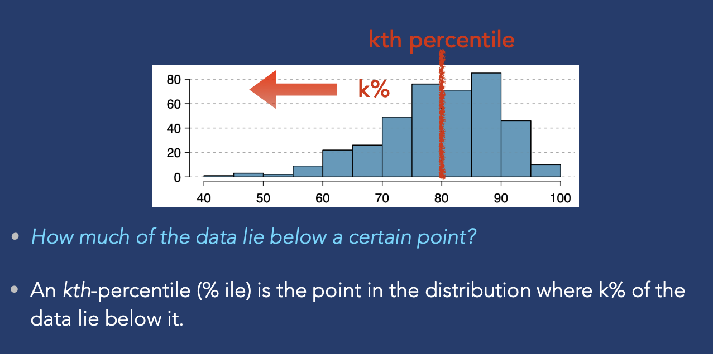
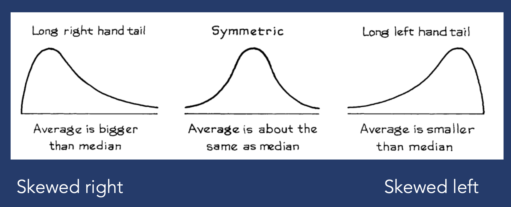
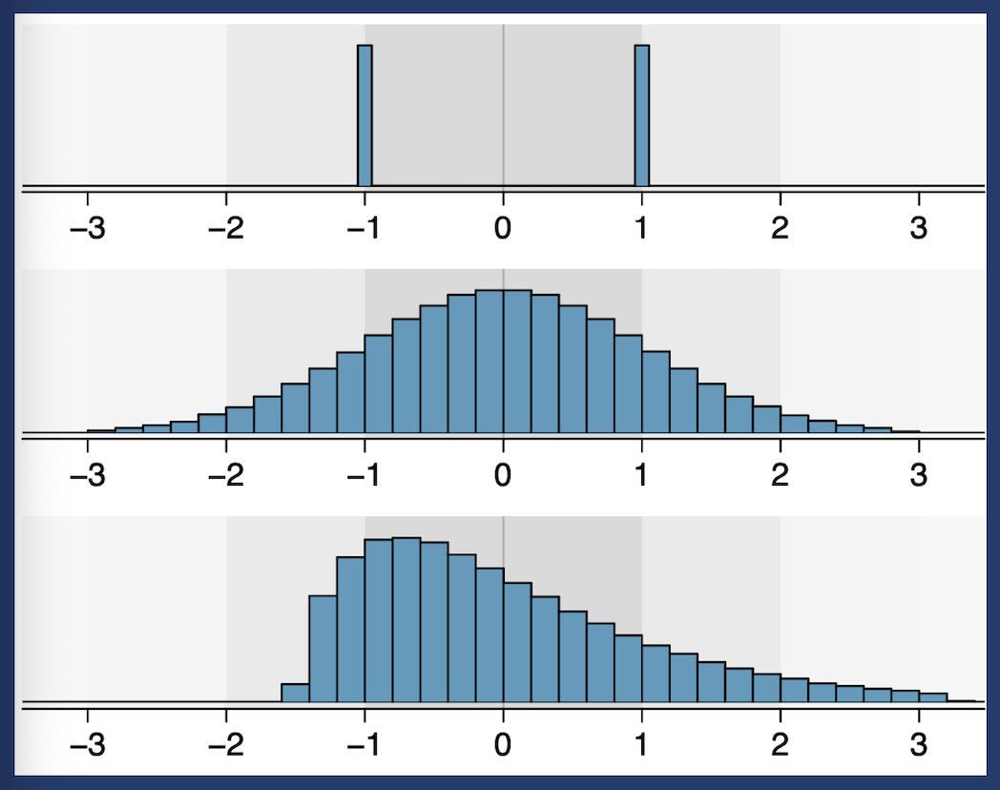

---
diagram:
  mermaid:
    theme: dark
format:
  revealjs:
    theme: [default, custom.scss]
    background-color: "#1e3a5f"
    slide-number: false
    controls: true
    progress: false
    transition: fade
    width: 1400
    height: 787
---

```{r}
#| include: false
library(ggplot2)

# Shared dark theme for all plots
theme_section <- function() {
  theme_minimal(base_size = 18) +
  theme(
    plot.background  = element_rect(fill = "#1e3a5f", color = NA),
    panel.background = element_rect(fill = "#1e3a5f", color = NA),
    panel.grid.major = element_line(color = "#ffffff22"),
    panel.grid.minor = element_blank(),
    text             = element_text(color = "white"),
    axis.text        = element_text(color = "#cccccc"),
    plot.title       = element_text(color = "#E5A823", size = 20, face = "bold")
  )
}
```

## {background-image="photos/IMG_4715.jpeg" background-size="cover" background-opacity="0.65"}

::: {style="position: absolute; top: 8%; left: 5%;"}
[STAT 5 SP 2026]{.teal style="font-size: 0.65em; letter-spacing: 0.2em; text-transform: uppercase; display: block; margin-bottom: 0.4em;"}

[SECTION 2]{style="font-size: 2.2em; font-weight: 300; letter-spacing: 0.08em; color: white;"}
:::

---

## Agenda

:::: {.columns}
::: {.column width="55%"}
- Discussion
- Week 2 Review
- Attendance Quiz
- Worksheet 2
:::
::: {.column width="45%"}
{style="border-radius: 8px; width: 100%; max-height: 480px; object-fit: cover;"}
:::
::::

---

## Announcement

<br>

Add course announcements here.

---

## What's Confusing?

<br>

[Turn to a neighbor:]{.gold style="font-weight: 600;"}

What from the past two weeks — lectures, homework, anything — is unclear?

<br>

*(We'll address the most common ones)*

---

## {background-image="photos/IMG_4765.jpeg" background-size="cover" background-opacity="0.55"}

::: {style="position: absolute; top: 8%; left: 5%;"}
[Week 2 Review]{.teal style="font-size: 0.65em; letter-spacing: 0.2em; text-transform: uppercase; display: block; margin-bottom: 0.4em; border: 1.5px solid #5BC8DB; padding: 0.2em 0.6em; display: inline-block;"}

[SUMMARIZING DATA]{style="font-size: 2em; font-weight: 300; letter-spacing: 0.08em; color: white;"}
:::

---

## Summary Statistics

We often want to summarize a distribution with [one number]{.gold}

<br>

- [What is a "typical" value?]{.gold} — measures of center
    - Mean (average), Median

- [What is the variability?]{.teal} — measures of spread
    - Standard Deviation, Variance, IQR, Range

---

## Percentiles

{style="width: 100%; max-height: 580px; object-fit: contain;"}

---

## Important Percentiles

<br>

- [**Median**]{.gold} — 50th percentile, also known as Q2
- [**Q1**]{.teal} (1st quartile) — 25th percentile
- [**Q3**]{.teal} (3rd quartile) — 75th percentile
    - [Q3 − Q1 = IQR]{.gold} — a measure of spread
- **Min** ≈ 1st percentile &nbsp;/&nbsp; **Max** ≈ 99th percentile

---

## Outliers

Unusually high or low values

- [Below Q1 − 1.5×IQR]{.gold} → low outlier
- [Above Q3 + 1.5×IQR]{.gold} → high outlier

<br>

- [**Resistant statistics**]{.teal} — outliers have little effect *(median, IQR)*
- [**Non-resistant**]{.teal} — outliers skew the value, have big impact *(mean, SD)*

---

## Measures of Center

<br>

- [**Mean**]{.teal} — sum of all values ÷ n *(not resistant)*
- [**Median**]{.teal} — middle value when sorted *(resistant)*
- [**Mode**]{.teal} — most frequent value; mainly useful for categorical data

---

## Skewness

{style="width: 100%; max-height: 460px; object-fit: contain;"}

::: {style="text-align: center; font-size: 0.85em; margin-top: 0.3em;"}
The tail tells you the direction — and the [mean gets pulled toward it]{.gold} &nbsp;·&nbsp; *"Average" = Mean here*
:::

---

## Measures of Spread

<br>

- [**Range**]{.teal} = max − min *(not resistant)*
- [**IQR**]{.teal} = Q3 − Q1 *(resistant)*
- [**Standard Deviation**]{.teal} — average distance from the mean *(not resistant)*

---

## Five-Number Summary & Boxplots

<br>

**Min &nbsp;—&nbsp; Q1 &nbsp;—&nbsp; Median &nbsp;—&nbsp; Q3 &nbsp;—&nbsp; Max**

<br>

- The *box* spans the middle 50% of the data (= IQR)
- Whiskers extend to the last non-outlier value
- Points beyond the whiskers = outliers

<br>

*(drawing on board)*

---

## Histogram: Iris Petal Lengths

```{r}
#| echo: false
#| fig-height: 4.2
#| fig-width: 9
ggplot(iris, aes(x = Petal.Length)) +
  geom_histogram(bins = 25, fill = "#5BC8DB", color = "#1e3a5f", alpha = 0.9) +
  labs(x = "Petal Length (cm)", y = "Count", title = "What do you notice?") +
  theme_section()
```

---

## Boxplot: Same Data

```{r}
#| echo: false
#| fig-height: 4.2
#| fig-width: 9
ggplot(iris, aes(y = "", x = Petal.Length)) +
  geom_boxplot(fill = "#5BC8DB", color = "white", alpha = 0.8, width = 0.35,
               outlier.color = "#E5A823", outlier.size = 3) +
  labs(y = "", x = "Petal Length (cm)", title = "What's now hidden?") +
  theme_section()
```

---

## Scatter Plots

<br>

Plot two [quantitative]{.teal} variables against each other

<br>

- [**Positive association**]{.gold} — as x goes up, y tends to go up
- [**Negative association**]{.gold} — as x goes up, y tends to go down
- [**No association**]{.gold} — no clear pattern

<br>

Correlation coefficient *r* measures strength and direction — more on this soon

---

## Choosing the Right Chart

<br>

- [**Categorical**]{.teal} → bar chart, pie chart
- [**Quantitative (one variable)**]{.teal} → histogram, stem-and-leaf
- [**Two quantitative variables**]{.teal} → scatter plot
- [**Change over time**]{.teal} → line chart

---

## Attendance Quiz {background-color="#1e3a5f"}

```{=html}
<div style="display: flex; gap: 2em; align-items: flex-start; height: 85%;">
  <div style="flex: 0 0 48%;">
    
    <p style="font-size: 0.5em; color: rgba(255,255,255,0.45); margin-top: 0.3em; text-align: center;">
      All three distributions have the same mean and standard deviation
    </p>
  </div>
  <div style="flex: 0 0 48%;">
    <p style="font-size: 0.7em; color: rgba(255,255,255,0.55); margin-bottom: 0.8em;">
      <em>Not graded on correctness — just scan in!</em>
    </p>
    <p style="font-size: 0.85em;">
      <span style="color: #E5A823; font-weight: 600;">Q1:</span>
      For each plot — Symmetric, Skewed Right, or Skewed Left?
    </p>
    <p style="font-size: 0.85em; margin-top: 0.6em;">
      <span style="color: #E5A823; font-weight: 600;">Q2:</span>
      For plots 2 and 3 — would the mean and median be the same? (yes / no)
    </p>
    <div style="text-align: center; margin-top: 2em;">
      <p style="font-size: 0.65em; color: rgba(255,255,255,0.75); margin-bottom: 0.4em;">
        Add your course attendance procedure here.
      </p>
    </div>
  </div>
</div>
```

---

## Discuss with a Neighbor

<br>

- [**Why is it important to plot your data?**]{.gold}

<br>

- [**What *type* of quantitative variable is each distribution?**]{.gold}

    *(Hint: look at what values they can take)*

---

## {background-image="photos/IMG_4591.jpeg" background-size="cover" background-opacity="0.55"}

::: {style="position: absolute; top: 8%; left: 5%;"}
[Worksheet 2]{.teal style="font-size: 0.65em; letter-spacing: 0.2em; text-transform: uppercase; display: block; margin-bottom: 0.4em; border: 1.5px solid #5BC8DB; padding: 0.2em 0.6em; display: inline-block;"}

[LET'S GET TO WORK]{style="font-size: 2em; font-weight: 300; letter-spacing: 0.08em; color: white;"}
:::

---

## Look at the Data First!

<br>

Before starting — open the [**`original_data` tab**]{.teal} in the spreadsheet

<br>

Scroll through. What do you notice?

<br>

[Seeing the data might make the concepts click more effortlessly.]{.gold}

---

## Tips: P1 — Summary Statistics

<br>

Useful functions — apply to a column range, e.g. `G2:G`:

- [`=AVERAGE(range)`]{.teal} &nbsp; [`=MEDIAN(range)`]{.teal} &nbsp; [`=MODE(range)`]{.teal}
- [`=QUARTILE(range, 1)`]{.teal} for Q1; &nbsp; [`=QUARTILE(range, 3)`]{.teal} for Q3
- [`=STDEV(range)`]{.teal} &nbsp; [`=MIN(range)`]{.teal} &nbsp; [`=MAX(range)`]{.teal}

<br>

[⚠ The tutorial uses column H (FRPM) — P1 asks for column G (enrollment)]{.gold}

---

## Tips: P2 — Histogram

<br>

- Insert → Chart → Chart type: **Histogram**
- [Google Sheets will grab the wrong range by default]{.gold} — manually set to `original_data!H2:H`
- Add a title and axis labels for full credit

<br>

*I'll go over this one with everyone*

---

## Tips: P3 — Stem-and-Leaf Plot

<br>

- **Stem** = tens digit &nbsp;|&nbsp; **Leaf** = units digit
- Sort leaves within each stem (smallest → largest)
- Always include a **key**, e.g.: &nbsp; `3 | 2` &nbsp; means 32 minutes
