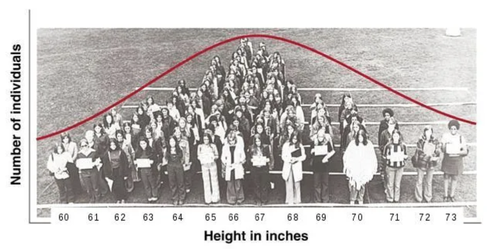

---
format:
  revealjs:
    theme: [default, custom.scss]
    background-color: "#1e3a5f"
    slide-number: false
    controls: true
    progress: false
    transition: fade
    width: 1400
    height: 787
---

```{r}
#| include: false
library(ggplot2)

theme_section <- function() {
  theme_minimal(base_size = 18) +
  theme(
    plot.background  = element_rect(fill = "#1e3a5f", color = NA),
    panel.background = element_rect(fill = "#1e3a5f", color = NA),
    panel.grid.major = element_line(color = "#ffffff22"),
    panel.grid.minor = element_blank(),
    text             = element_text(color = "white"),
    axis.text        = element_text(color = "#cccccc"),
    plot.title       = element_text(color = "#E5A823", size = 20, face = "bold")
  )
}

# helper: normal curve with shaded region
shade_normal <- function(mu, sigma, shade_from, shade_to,
                         title = "", xlab = "",
                         shade_col = "#5BC8DB55",
                         line_col = "#5BC8DB",
                         xlim_low = mu - 3.5 * sigma,
                         xlim_high = mu + 3.5 * sigma) {
  x_all <- seq(xlim_low, xlim_high, length.out = 400)
  y_all <- dnorm(x_all, mu, sigma)
  x_shade <- seq(max(shade_from, xlim_low), min(shade_to, xlim_high), length.out = 400)
  y_shade <- dnorm(x_shade, mu, sigma)

  gap <- max(y_all) * 0.03
  df_curve <- data.frame(x = x_all, y = y_all)
  df_shade <- data.frame(x = c(x_shade[1], x_shade, x_shade[length(x_shade)]),
                         y = c(gap, y_shade, gap))

  ggplot() +
    geom_polygon(data = df_shade, aes(x, y),
                 fill = shade_col, color = NA) +
    geom_line(data = df_curve, aes(x, y),
              color = line_col, linewidth = 1.5) +
    geom_vline(xintercept = mu, color = "#E5A823", linewidth = 0.8, linetype = "dashed") +
    labs(title = title, x = xlab, y = "") +
    scale_y_continuous(expand = expansion(mult = c(0.05, 0))) +
    theme_section() +
    theme(axis.text.y = element_blank(),
          axis.ticks.y = element_blank(),
          plot.title = element_text(size = 18))
}

# helper: binomial bar chart with highlighted bars
binom_bar <- function(n, p, highlight_fn, title = "",
                      hi_col = "#E5A823", lo_col = "#5BC8DB33") {
  x <- 0:n
  probs <- dbinom(x, n, p)
  df <- data.frame(x = x, prob = probs)
  df$fill <- ifelse(highlight_fn(x), "hi", "lo")

  ggplot(df, aes(x = x, y = prob, fill = fill)) +
    geom_col(width = 0.7) +
    scale_fill_manual(values = c("hi" = hi_col, "lo" = lo_col), guide = "none") +
    labs(title = title, x = "X", y = "") +
    scale_y_continuous(expand = c(0, 0)) +
    theme_section() +
    theme(axis.text.y = element_blank(), axis.ticks.y = element_blank(),
          plot.title = element_text(size = 16))
}
```

## {background-image="photos/chi_lake.jpeg" background-size="cover" background-opacity="0.65"}

::: {style="position: absolute; top: 8%; left: 5%;"}
[STAT 5 SP 2026]{.teal style="font-size: 0.65em; letter-spacing: 0.2em; text-transform: uppercase; display: block; margin-bottom: 0.4em;"}

[SECTION 5]{style="font-size: 2.2em; font-weight: 300; letter-spacing: 0.08em; color: white;"}
:::

---

## Agenda

:::: {.columns}
::: {.column width="55%"}
- Preview of the second half
- Random variables & the normal distribution
- Z-scores & normal calculations
- Attendance quiz
- Worksheet 4
:::
::: {.column width="45%"}
{style="border-radius: 8px; width: 100%; max-height: 480px; object-fit: cover;"}
:::
::::

---

## {background-image="photos/chi_river.jpeg" background-size="cover" background-opacity="0.55"}

::: {style="position: absolute; top: 8%; left: 5%;"}
[Preview]{.teal style="font-size: 0.65em; letter-spacing: 0.2em; text-transform: uppercase; display: block; margin-bottom: 0.4em; border: 1.5px solid #5BC8DB; padding: 0.2em 0.6em; display: inline-block;"}

[SECOND HALF OF THE COURSE]{style="font-size: 2em; font-weight: 300; letter-spacing: 0.08em; color: white;"}
:::

---

## The Big Picture

```{=html}
<div style="display: flex; justify-content: center; margin-top: 1.8em;">
  <div style="position: relative; width: 860px; height: 360px;">
    <svg width="860" height="360" viewBox="0 0 860 360" role="img" aria-label="Loop from data generating process to observed data and back">
      <defs>
        <marker id="arrowhead" markerWidth="10" markerHeight="7" refX="9" refY="3.5" orient="auto">
          <polygon points="0 0, 10 3.5, 0 7" fill="#E5A823"></polygon>
        </marker>
      </defs>
      <path d="M250,128 C330,10 530,10 610,128" fill="none" stroke="#E5A823" stroke-width="3" marker-end="url(#arrowhead)"></path>
      <path d="M610,232 C530,350 330,362 250,248" fill="none" stroke="#E5A823" stroke-width="3" marker-end="url(#arrowhead)"></path>
      <text x="430" y="20" fill="#E5A823" text-anchor="middle" font-size="28" font-weight="600">probability</text>
      <text x="430" y="352" fill="#E5A823" text-anchor="middle" font-size="28" font-weight="600">inference</text>
    </svg>

    <div style="position: absolute; top: 122px; left: 12px; background: rgba(91,200,219,0.15); border: 2px solid #5BC8DB; border-radius: 10px; padding: 1em 1.5em; text-align: center; min-width: 190px;">
      <div style="color: #5BC8DB; font-weight: 600; font-size: 1.05em; line-height: 1.6;">Data Generating<br>Process</div>
    </div>
    <div style="position: absolute; top: 122px; right: 12px; background: rgba(255,255,255,0.08); border: 2px solid rgba(255,255,255,0.3); border-radius: 10px; padding: 1em 1.5em; text-align: center; min-width: 180px;">
      <div style="color: white; font-weight: 600; font-size: 1.05em; line-height: 1.6;">Observed<br>Data</div>
    </div>
  </div>
</div>
<div style="text-align: center; margin-top: 2em; font-size: 0.7em; color: rgba(255,255,255,0.45);">
  Weeks 1–4: described the data &nbsp;·&nbsp; Now: we model the mechanism and draw conclusions
</div>
```

---

## Probability Models

<br>

:::: {.columns}
::: {.column width="50%"}
Section 3: M&M Jar

| <span style="color:#5BC8DB; font-weight:600;">Blue</span> | <span style="color:#E85D5D; font-weight:600;">Red</span> | <span style="color:#F6D743; font-weight:600;">Yellow</span> |
|:----:|:---:|:------:|
| 45   | 40  | 15     |

One draw = one M&M
:::
::: {.column width="50%"}
Polling Model

| <span style="color:#5BC8DB; font-weight:600;">Dem</span> | <span style="color:#E85D5D; font-weight:600;">Rep</span> | <span style="color:#F6D743; font-weight:600;">Neither</span> |
|:---:|:---:|:-------:|
| 45% | 40% | 15%     |

One call = one voter
:::
::::

<br>

The jar [**is**]{.gold} a probability model for the poll

<br>

::: {style="font-size: 0.85em; color: rgba(255,255,255,0.65);"}
*For continuous measurements, there's another model: the **Normal distribution***
:::

---

## Normal Distributions in Nature

<br>

Many natural measurements cluster near a typical value — with fewer extremes

<br>

:::: {.columns}
::: {.column width="55%"}
{style="border-radius: 8px; width: 100%;"}
:::
::: {.column width="45%"}
Heights, shoe sizes, blood pressure, typing speed, reaction times, daily caffeine intake...

<br>

This shape keeps showing up — so we give it a name and study its properties
:::
::::

---

## The Big Picture

```{=html}
<div style="display: flex; justify-content: center; margin-top: 1.8em;">
  <div style="position: relative; width: 860px; height: 360px;">
    <svg width="860" height="360" viewBox="0 0 860 360" role="img" aria-label="Loop from Normal model to observed data and back">
      <defs>
        <marker id="arrowhead2" markerWidth="10" markerHeight="7" refX="9" refY="3.5" orient="auto">
          <polygon points="0 0, 10 3.5, 0 7" fill="#E5A823"></polygon>
        </marker>
      </defs>
      <path d="M250,128 C330,10 530,10 610,128" fill="none" stroke="#E5A823" stroke-width="3" marker-end="url(#arrowhead2)"></path>
      <path d="M610,232 C530,350 330,362 250,248" fill="none" stroke="#E5A823" stroke-width="3" marker-end="url(#arrowhead2)"></path>
      <text x="430" y="20" fill="#E5A823" text-anchor="middle" font-size="28" font-weight="600">probability</text>
      <text x="430" y="352" fill="#E5A823" text-anchor="middle" font-size="28" font-weight="600">inference</text>
    </svg>

    <div style="position: absolute; top: 122px; left: 12px; background: rgba(91,200,219,0.15); border: 2px solid #5BC8DB; border-radius: 10px; padding: 1em 1.5em; text-align: center; min-width: 190px;">
      <div style="color: #5BC8DB; font-weight: 600; font-size: 1.05em; line-height: 1.6;">Normal<br>Model</div>
    </div>
    <div style="position: absolute; top: 122px; right: 12px; background: rgba(255,255,255,0.08); border: 2px solid rgba(255,255,255,0.3); border-radius: 10px; padding: 1em 1.5em; text-align: center; min-width: 180px;">
      <div style="color: white; font-weight: 600; font-size: 1.05em; line-height: 1.6;">Observed<br>Data</div>
    </div>
  </div>
</div>
<div style="text-align: center; margin-top: 2em; font-size: 0.7em; color: rgba(255,255,255,0.45);">
  The Normal model is the bridge between probability and inference
</div>
```

---

## The Second Half

<br>

Weeks 6–10 build on each other

<br>

The [**next two sections**]{.gold} are really important for understanding the rest of the course

<br>

Today: fluency with the [normal model]{.teal}. Everything downstream depends on this.

<br>

::: {style="color: rgba(255,255,255,0.65); font-size: 0.85em;"}
*Normal model → sampling distributions → confidence intervals → hypothesis tests*
:::

---

## {background-image="photos/wrigley_field.jpeg" background-size="cover" background-opacity="0.55"}

::: {style="position: absolute; top: 8%; left: 5%;"}
[Building Intuition]{.teal style="font-size: 0.65em; letter-spacing: 0.2em; text-transform: uppercase; display: block; margin-bottom: 0.4em; border: 1.5px solid #5BC8DB; padding: 0.2em 0.6em; display: inline-block;"}

[RANDOM VARIABLES]{style="font-size: 2em; font-weight: 300; letter-spacing: 0.08em; color: white;"}
:::

---

## One Draw from the Population

<br>

:::: {.columns}
::: {.column width="55%"}
| Democrat | Not Democrat |
|:--------:|:------------:|
| 45%      | 55%          |

<br>

Let $X$ = number of Democrats from [one]{.gold} draw

$P(X = 1) = 0.45$ — person is a Democrat

$P(X = 0) = 0.55$ — person is not a Democrat
:::
::: {.column width="45%"}
```{r}
#| echo: false
#| fig-width: 4
#| fig-height: 3.2
df_one <- data.frame(x = factor(c(0, 1)), prob = c(0.55, 0.45))

ggplot(df_one, aes(x = x, y = prob, fill = x)) +
  geom_col(width = 0.5) +
  scale_fill_manual(values = c("0" = "#E5A82388", "1" = "#5BC8DB88"), guide = "none") +
  labs(x = "X", y = "") +
  scale_y_continuous(expand = c(0, 0), limits = c(0, 0.65)) +
  theme_section() +
  theme(axis.text.y = element_blank(), axis.ticks.y = element_blank()) +
  annotate("text", x = 1, y = 0.59, label = "0.55", color = "#E5A823", size = 6) +
  annotate("text", x = 2, y = 0.49, label = "0.45", color = "#5BC8DB", size = 6)
```
:::
::::

---

## 25 Draws: P(X = 5)

| Democrat | Not Democrat |
|:--------:|:------------:|
| 45%      | 55%          |

Let $X$ = number of Democrats from [25]{.gold} draws — $X \sim \text{Binomial}(25, 0.45)$

:::: {.columns}
::: {.column width="55%"}
```{r}
#| echo: false
#| fig-width: 6
#| fig-height: 3.8
binom_bar(25, 0.45, function(x) x == 5, title = "P(X = 5)") +
  annotate("text", x = 5, y = dbinom(5, 25, 0.45) + 0.008,
           label = paste0("≈ ", round(dbinom(5, 25, 0.45), 3)),
           color = "#E5A823", size = 4.5, fontface = "bold")
```
:::
::: {.column width="45%"}
$P(X = 5)$ — [exactly 5]{.teal} of the 25 are Democrats

<br>

::: {style="font-size: 0.85em; color: rgba(255,255,255,0.65);"}
*A single bar in the histogram*
:::
:::
::::

---

## 25 Draws: P(X > 5)

$X \sim \text{Binomial}(25, 0.45)$

:::: {.columns}
::: {.column width="55%"}
```{r}
#| echo: false
#| fig-width: 6
#| fig-height: 3.8
binom_bar(25, 0.45, function(x) x > 5, title = "P(X > 5)") +
  annotate("text", x = 15, y = 0.14,
           label = paste0("≈ ", round(1 - pbinom(5, 25, 0.45), 3)),
           color = "#E5A823", size = 4.5, fontface = "bold")
```
:::
::: {.column width="45%"}
$P(X > 5)$ — [more than 5]{.teal} of the 25 are Democrats

<br>

::: {style="font-size: 0.85em; color: rgba(255,255,255,0.65);"}
*Sum of all bars to the right of 5*
:::
:::
::::

---

## 25 Draws: Between Two Values

<br>

:::: {.columns}
::: {.column width="55%"}
```{r}
#| echo: false
#| fig-width: 6
#| fig-height: 3.8
binom_bar(25, 0.45, function(x) x > 5 & x < 10, title = "P(5 < X < 10)") +
  annotate("text", x = 7.5, y = 0.12,
           label = paste0("≈ ", round(pbinom(9, 25, 0.45) - pbinom(5, 25, 0.45), 3)),
           color = "#E5A823", size = 5, fontface = "bold")
```
:::
::: {.column width="45%"}
[Between 5 and 10]{.teal} (non-inclusive)

"6, 7, 8, or 9 of the 25 are Democrats"

<br>

::: {style="font-size: 0.85em; color: rgba(255,255,255,0.65);"}
*Same idea applies to continuous distributions — we'll see $P(a < X < b)$ again with the Normal*
:::
:::
::::

---

## Two Types of Random Variables

<br>

:::: {.columns}
::: {.column width="50%"}
[Discrete]{.teal style="font-weight: 600;"}

Takes countable values

- number of heads in 10 flips
- ACT score (1–36)
- number of Democrats called

Common model: [**Binomial**]{.gold}

::: {style="font-size: 0.85em; color: rgba(255,255,255,0.65);"}
*(the voter example we just saw)*
:::
:::
::: {.column width="50%"}
[Continuous]{.teal style="font-weight: 600;"}

Takes any value in an interval

- height, weight, temperature
- flipper length (mm)
- time

Common model: [**Normal**]{.gold} — today's focus
:::
::::

---

## {background-image="photos/chi_flag.jpeg" background-size="cover" background-opacity="0.55"}

::: {style="position: absolute; top: 8%; left: 5%;"}
[Week 6 Review]{.teal style="font-size: 0.65em; letter-spacing: 0.2em; text-transform: uppercase; display: block; margin-bottom: 0.4em; border: 1.5px solid #5BC8DB; padding: 0.2em 0.6em; display: inline-block;"}

[NORMAL DISTRIBUTION]{style="font-size: 2em; font-weight: 300; letter-spacing: 0.08em; color: white;"}
:::

---

## Normal Distribution Review

<br>

Bell-shaped, symmetric — described by [**mean**]{.teal} $\mu$ and [**standard deviation**]{.teal} $\sigma$

Notation: $X \sim N(\mu, \sigma)$

<br>

```{=html}
<div style="display: flex; justify-content: center; margin-top: 0.6em; margin-bottom: 0.6em;">
  <svg width="720" height="220" viewBox="0 0 720 220" role="img" aria-label="Normal distribution curve with mean and standard deviation markers">
    <line x1="60" y1="180" x2="660" y2="180" stroke="rgba(255,255,255,0.55)" stroke-width="2"></line>
    <path d="M90,180 C180,180 220,45 360,45 C500,45 540,180 630,180" fill="none" stroke="#5BC8DB" stroke-width="4"></path>
    <line x1="360" y1="180" x2="360" y2="52" stroke="#E5A823" stroke-width="2.5"></line>
    <line x1="270" y1="180" x2="270" y2="102" stroke="rgba(255,255,255,0.45)" stroke-width="2"></line>
    <line x1="450" y1="180" x2="450" y2="102" stroke="rgba(255,255,255,0.45)" stroke-width="2"></line>
    <text x="360" y="198" fill="#E5A823" text-anchor="middle" font-size="15">μ</text>
    <text x="270" y="198" fill="rgba(255,255,255,0.75)" text-anchor="middle" font-size="14">μ − σ</text>
    <text x="450" y="198" fill="rgba(255,255,255,0.75)" text-anchor="middle" font-size="14">μ + σ</text>
  </svg>
</div>
```

---

## Probability as Area

<br>

:::: {.columns}
::: {.column width="50%"}
$P(X < x)$ means:

"What is the [probability]{.teal} that $X$ takes a value [less than]{.gold} $x$?"

<br>

For a normal distribution, this equals the [**shaded area**]{.teal} under the curve to the left of $x$
:::
::: {.column width="50%"}
```{r}
#| echo: false
#| fig-width: 6
#| fig-height: 3.8
shade_normal(0, 1, -4, 1, title = "P(X < x)", xlab = "x") +
  annotate("text", x = 1, y = -0.01, label = "x", color = "#E5A823",
           size = 6, fontface = "bold")
```
:::
::::

---

## P(X = Exact Value) = 0

<br>

:::: {.columns}
::: {.column width="50%"}
For [continuous]{.teal} distributions, the probability of any single exact value is [**zero**]{.gold}

<br>

Why? Probability = area, and a line has [no width]{.teal} → no area

<br>

This is why we always compute [ranges]{.gold}:

$P(X < a)$, $P(X > a)$, $P(a < X < b)$
:::
::: {.column width="50%"}
```{r}
#| echo: false
#| fig-width: 6
#| fig-height: 3.8
x_all <- seq(-3.5, 3.5, length.out = 400)
y_all <- dnorm(x_all)
df_curve <- data.frame(x = x_all, y = y_all)

ggplot(df_curve, aes(x, y)) +
  geom_line(color = "#5BC8DB", linewidth = 1.5) +
  geom_segment(aes(x = 1, xend = 1, y = 0, yend = dnorm(1)),
               color = "#E5A823", linewidth = 2) +
  geom_vline(xintercept = 0, color = "#E5A823", linewidth = 0.8, linetype = "dashed") +
  annotate("text", x = 1, y = -0.02, label = "a", color = "#E5A823",
           size = 7, fontface = "bold") +
  annotate("text", x = 2.2, y = dnorm(1) + 0.02, label = "No width → no area",
           color = "#E5A823", size = 5, hjust = 0) +
  labs(title = "P(X = a) = 0", x = "", y = "") +
  scale_y_continuous(expand = c(0, 0)) +
  theme_section() +
  theme(axis.text = element_blank(), axis.ticks = element_blank(),
        plot.title = element_text(size = 18))
```
:::
::::

---

## Left Tail: $P(X < a)$

:::: {.columns}
::: {.column width="50%"}
```{r}
#| echo: false
#| fig-width: 6
#| fig-height: 4.2
shade_normal(20.8, 5.8, -5, 15,
             title = "P(ACT < 15)",
             xlab = "ACT Score") +
  annotate("text", x = 15, y = -0.001, label = "15", color = "#E5A823",
           size = 5, fontface = "bold")
```
:::
::: {.column width="50%"}
<br>

Direct lookup — the simplest case

<br>

::: {style="font-size: 0.85em; color: rgba(255,255,255,0.65);"}
*"What proportion of students scored below 15?"*
:::
:::
::::

---

## Right Tail: $P(X > a)$

:::: {.columns}
::: {.column width="50%"}
```{r}
#| echo: false
#| fig-width: 6
#| fig-height: 4.2
shade_normal(20.8, 5.8, 30, 50,
             title = "P(ACT > 30)",
             xlab = "ACT Score") +
  annotate("text", x = 30, y = -0.001, label = "30", color = "#E5A823",
           size = 5, fontface = "bold")
```
:::
::: {.column width="50%"}
<br>

Use the [complement]{.teal}:

$$P(X > a) = 1 - P(X < a)$$

<br>

::: {style="font-size: 0.85em; color: rgba(255,255,255,0.65);"}
*"What proportion scored above 30?"*
:::
:::
::::

---

## Between: $P(a < X < b)$

:::: {.columns}
::: {.column width="50%"}
```{r}
#| echo: false
#| fig-width: 6
#| fig-height: 4.2
shade_normal(20.8, 5.8, 15, 26.6,
             title = "P(15 < ACT < 26.6)",
             xlab = "ACT Score") +
  annotate("text", x = 15, y = -0.001, label = "15", color = "#E5A823",
           size = 5, fontface = "bold") +
  annotate("text", x = 26.6, y = -0.001, label = "26.6", color = "#E5A823",
           size = 5, fontface = "bold")
```
:::
::: {.column width="50%"}
<br>

Use the [difference]{.teal}:

$$P(a < X < b) = P(X < b) - P(X < a)$$

<br>

::: {style="font-size: 0.85em; color: rgba(255,255,255,0.65);"}
*"What proportion scored between 15 and 26.6?"*
:::
:::
::::

---

## Both Tails: $P(X < a) + P(X > b)$

:::: {.columns}
::: {.column width="50%"}
```{r}
#| echo: false
#| fig-width: 6
#| fig-height: 4.2
# shade both tails
x_all <- seq(20.8 - 3.5*5.8, 20.8 + 3.5*5.8, length.out = 400)
y_all <- dnorm(x_all, 20.8, 5.8)
df_curve <- data.frame(x = x_all, y = y_all)

gap <- max(y_all) * 0.03
# lower tail
x_lo <- seq(min(x_all), 20.8 - 2*5.8, length.out = 200)
y_lo <- dnorm(x_lo, 20.8, 5.8)
df_lo <- data.frame(x = c(x_lo[1], x_lo, x_lo[length(x_lo)]),
                    y = c(gap, y_lo, gap))
# upper tail
x_hi <- seq(20.8 + 2*5.8, max(x_all), length.out = 200)
y_hi <- dnorm(x_hi, 20.8, 5.8)
df_hi <- data.frame(x = c(x_hi[1], x_hi, x_hi[length(x_hi)]),
                    y = c(gap, y_hi, gap))

ggplot() +
  geom_polygon(data = df_lo, aes(x, y), fill = "#5BC8DB55", color = NA) +
  geom_polygon(data = df_hi, aes(x, y), fill = "#5BC8DB55", color = NA) +
  geom_line(data = df_curve, aes(x, y), color = "#5BC8DB", linewidth = 1.5) +
  geom_vline(xintercept = 20.8, color = "#E5A823", linewidth = 0.8, linetype = "dashed") +
  annotate("text", x = 20.8 - 2*5.8, y = dnorm(20.8 - 2*5.8, 20.8, 5.8) + 0.003,
           label = "9.2", color = "#E5A823", size = 5, fontface = "bold") +
  annotate("text", x = 20.8 + 2*5.8, y = dnorm(20.8 + 2*5.8, 20.8, 5.8) + 0.003,
           label = "32.4", color = "#E5A823", size = 5, fontface = "bold") +
  labs(title = "P(ACT < 9.2) + P(ACT > 32.4)", x = "ACT Score", y = "") +
  scale_y_continuous(expand = expansion(mult = c(0.05, 0))) +
  theme_section() +
  theme(axis.text.y = element_blank(), axis.ticks.y = element_blank(),
        plot.title = element_text(size = 18))
```
:::
::: {.column width="50%"}
<br>

Add both tails:

$$P(X < 9.2) + P(X > 32.4)$$

<br>

::: {style="font-size: 0.85em; color: rgba(255,255,255,0.65);"}
*"What proportion scored more than 2 SDs from the mean?"*
:::
:::
::::

---

## Empirical Rule

<br>

:::: {.columns}
::: {.column width="33%"}
```{r}
#| echo: false
#| fig-width: 4.2
#| fig-height: 3.2
shade_normal(0, 1, -1, 1, title = "68% within ±1 SD",
             shade_col = "#E5A82344") +
  annotate("text", x = 0, y = 0.17, label = "68%",
           color = "#E5A823", size = 7, fontface = "bold") +
  theme(axis.text.x = element_blank())
```
:::
::: {.column width="33%"}
```{r}
#| echo: false
#| fig-width: 4.2
#| fig-height: 3.2
shade_normal(0, 1, -2, 2, title = "95% within ±2 SDs",
             shade_col = "#E5A82344") +
  annotate("text", x = 0, y = 0.17, label = "95%",
           color = "#E5A823", size = 7, fontface = "bold") +
  theme(axis.text.x = element_blank())
```
:::
::: {.column width="33%"}
```{r}
#| echo: false
#| fig-width: 4.2
#| fig-height: 3.2
shade_normal(0, 1, -3, 3, title = "99.7% within ±3 SDs",
             shade_col = "#E5A82344") +
  annotate("text", x = 0, y = 0.17, label = "99.7%",
           color = "#E5A823", size = 7, fontface = "bold") +
  theme(axis.text.x = element_blank())
```
:::
::::

<br>

::: {style="font-size: 0.85em; color: rgba(255,255,255,0.65); text-align: center;"}
*If 68% is within ±1 SD → 32% is outside → [16%]{.gold} in each tail*
:::

---

## {background-image="photos/chi_concert.jpeg" background-size="cover" background-opacity="0.55"}

::: {style="position: absolute; top: 8%; left: 5%;"}
[Core Skill]{.teal style="font-size: 0.65em; letter-spacing: 0.2em; text-transform: uppercase; display: block; margin-bottom: 0.4em; border: 1.5px solid #5BC8DB; padding: 0.2em 0.6em; display: inline-block;"}

[MECHANICS]{style="font-size: 2em; font-weight: 300; letter-spacing: 0.08em; color: white;"}
:::

---

## Tools for Finding Areas

<br>

Two ways to find $P(X < x)$:

<br>

- [Z-table]{.gold} (on exams): standardize first ($z = \frac{x - \mu}{\sigma}$), then look up $z$, get left-tail area
- [Google Sheets]{.gold} (on worksheets): `NORMDIST(x, mean, sd, TRUE)`

<br>

Both give the same answer: $P(X < x)$

---

## What Is a Z-Score?

<br>

$$z = \frac{x - \mu}{\sigma}$$

<br>

"How many [standard deviations]{.teal} is $x$ from the mean?"

<br>

- Positive $z$ → above the mean · Negative $z$ → below · $z = 0$ → at the mean
- If $X \sim N(\mu, \sigma)$, then standardizing gives the [**standard normal**]{.gold}: $Z \sim N(0, 1)$

---

## Z-Score Example

<br>

[ACT scores:]{.gold style="font-weight: 600;"} $\mu = 20.8$, $\sigma = 5.8$

<br>

Score of [30]{.teal}: $\quad z = \frac{30 - 20.8}{5.8} = \frac{9.2}{5.8} \approx 1.59$

→ "about 1.6 standard deviations [above]{.teal} average"

<br>

Score of [13]{.teal}: $\quad z = \frac{13 - 20.8}{5.8} = \frac{-7.8}{5.8} \approx -1.34$

→ "about 1.3 standard deviations [below]{.teal} average"

---

## Z-Table Lookup

[Example:]{.gold style="font-weight: 600;"} What proportion scored below 30? → $z = \frac{30 - 20.8}{5.8} \approx 1.59$ → find row [1.5]{.teal}, column [.09]{.teal}

```{=html}
<div style="display: flex; justify-content: center; margin-top: 0.8em;">
<table style="border-collapse: collapse; font-size: 0.72em; font-family: 'Courier New', monospace;">
  <tr>
    <th style="padding: 0.4em 0.7em; border: 1px solid rgba(255,255,255,0.25); color: #5BC8DB; background: rgba(91,200,219,0.1);">z</th>
    <th style="padding: 0.4em 0.7em; border: 1px solid rgba(255,255,255,0.25); color: rgba(255,255,255,0.7);">.00</th>
    <th style="padding: 0.4em 0.7em; border: 1px solid rgba(255,255,255,0.25); color: rgba(255,255,255,0.7);">.01</th>
    <th style="padding: 0.4em 0.7em; border: 1px solid rgba(255,255,255,0.25); color: rgba(255,255,255,0.7);">.02</th>
    <th style="padding: 0.4em 0.7em; border: 1px solid rgba(255,255,255,0.25); color: rgba(255,255,255,0.7);">.03</th>
    <th style="padding: 0.4em 0.7em; border: 1px solid rgba(255,255,255,0.25); color: rgba(255,255,255,0.7);">.04</th>
    <th style="padding: 0.4em 0.7em; border: 1px solid rgba(255,255,255,0.25); color: rgba(255,255,255,0.7);">.05</th>
    <th style="padding: 0.4em 0.7em; border: 1px solid rgba(255,255,255,0.25); color: rgba(255,255,255,0.7);">.06</th>
    <th style="padding: 0.4em 0.7em; border: 1px solid rgba(255,255,255,0.25); color: rgba(255,255,255,0.7);">.07</th>
    <th style="padding: 0.4em 0.7em; border: 1px solid rgba(255,255,255,0.25); color: rgba(255,255,255,0.7);">.08</th>
    <th style="padding: 0.4em 0.7em; border: 1px solid rgba(255,255,255,0.25); color: #E5A823; font-weight: bold;">.09</th>
  </tr>
  <tr>
    <td style="padding: 0.4em 0.7em; border: 1px solid rgba(255,255,255,0.25); color: rgba(255,255,255,0.5);">1.4</td>
    <td style="padding: 0.4em 0.7em; border: 1px solid rgba(255,255,255,0.25); color: rgba(255,255,255,0.5);">.9192</td>
    <td style="padding: 0.4em 0.7em; border: 1px solid rgba(255,255,255,0.25); color: rgba(255,255,255,0.5);">.9207</td>
    <td style="padding: 0.4em 0.7em; border: 1px solid rgba(255,255,255,0.25); color: rgba(255,255,255,0.5);">.9222</td>
    <td style="padding: 0.4em 0.7em; border: 1px solid rgba(255,255,255,0.25); color: rgba(255,255,255,0.5);">.9236</td>
    <td style="padding: 0.4em 0.7em; border: 1px solid rgba(255,255,255,0.25); color: rgba(255,255,255,0.5);">.9251</td>
    <td style="padding: 0.4em 0.7em; border: 1px solid rgba(255,255,255,0.25); color: rgba(255,255,255,0.5);">.9265</td>
    <td style="padding: 0.4em 0.7em; border: 1px solid rgba(255,255,255,0.25); color: rgba(255,255,255,0.5);">.9279</td>
    <td style="padding: 0.4em 0.7em; border: 1px solid rgba(255,255,255,0.25); color: rgba(255,255,255,0.5);">.9292</td>
    <td style="padding: 0.4em 0.7em; border: 1px solid rgba(255,255,255,0.25); color: rgba(255,255,255,0.5);">.9306</td>
    <td style="padding: 0.4em 0.7em; border: 1px solid rgba(255,255,255,0.25); color: rgba(255,255,255,0.5);">.9319</td>
  </tr>
  <tr>
    <td style="padding: 0.4em 0.7em; border: 1px solid rgba(255,255,255,0.25); color: #5BC8DB; font-weight: bold;">1.5</td>
    <td style="padding: 0.4em 0.7em; border: 1px solid rgba(255,255,255,0.25); color: white;">.9332</td>
    <td style="padding: 0.4em 0.7em; border: 1px solid rgba(255,255,255,0.25); color: white;">.9345</td>
    <td style="padding: 0.4em 0.7em; border: 1px solid rgba(255,255,255,0.25); color: white;">.9357</td>
    <td style="padding: 0.4em 0.7em; border: 1px solid rgba(255,255,255,0.25); color: white;">.9370</td>
    <td style="padding: 0.4em 0.7em; border: 1px solid rgba(255,255,255,0.25); color: white;">.9382</td>
    <td style="padding: 0.4em 0.7em; border: 1px solid rgba(255,255,255,0.25); color: white;">.9394</td>
    <td style="padding: 0.4em 0.7em; border: 1px solid rgba(255,255,255,0.25); color: white;">.9406</td>
    <td style="padding: 0.4em 0.7em; border: 1px solid rgba(255,255,255,0.25); color: white;">.9418</td>
    <td style="padding: 0.4em 0.7em; border: 1px solid rgba(255,255,255,0.25); color: white;">.9429</td>
    <td style="padding: 0.4em 0.7em; border: 1px solid rgba(255,255,255,0.25); background: #E5A823; color: #1e3a5f; font-weight: bold;">.9441</td>
  </tr>
  <tr>
    <td style="padding: 0.4em 0.7em; border: 1px solid rgba(255,255,255,0.25); color: rgba(255,255,255,0.5);">1.6</td>
    <td style="padding: 0.4em 0.7em; border: 1px solid rgba(255,255,255,0.25); color: rgba(255,255,255,0.5);">.9452</td>
    <td style="padding: 0.4em 0.7em; border: 1px solid rgba(255,255,255,0.25); color: rgba(255,255,255,0.5);">.9463</td>
    <td style="padding: 0.4em 0.7em; border: 1px solid rgba(255,255,255,0.25); color: rgba(255,255,255,0.5);">.9474</td>
    <td style="padding: 0.4em 0.7em; border: 1px solid rgba(255,255,255,0.25); color: rgba(255,255,255,0.5);">.9484</td>
    <td style="padding: 0.4em 0.7em; border: 1px solid rgba(255,255,255,0.25); color: rgba(255,255,255,0.5);">.9495</td>
    <td style="padding: 0.4em 0.7em; border: 1px solid rgba(255,255,255,0.25); color: rgba(255,255,255,0.5);">.9505</td>
    <td style="padding: 0.4em 0.7em; border: 1px solid rgba(255,255,255,0.25); color: rgba(255,255,255,0.5);">.9515</td>
    <td style="padding: 0.4em 0.7em; border: 1px solid rgba(255,255,255,0.25); color: rgba(255,255,255,0.5);">.9525</td>
    <td style="padding: 0.4em 0.7em; border: 1px solid rgba(255,255,255,0.25); color: rgba(255,255,255,0.5);">.9535</td>
    <td style="padding: 0.4em 0.7em; border: 1px solid rgba(255,255,255,0.25); color: rgba(255,255,255,0.5);">.9545</td>
  </tr>
</table>
</div>
```

$P(Z < 1.59) = .9441$ → about [94.4%]{.gold} scored below 30

::: {style="font-size: 0.75em; color: rgba(255,255,255,0.5); text-align: center;"}
Row = tenths digit of z · Column = hundredths digit
:::

---

## Going Backwards

<br>

Sometimes you know the [probability]{.teal} (area) and want to find the [value]{.gold}

<br>

[Z-table:]{.gold style="font-weight: 600;"} find the probability in the body of the table → read the $z$-value → convert back:

$$x = \mu + z \cdot \sigma$$

<br>

[Example:]{.teal style="font-weight: 600;"} What ACT score is the 82nd percentile?

1. Find $.8200$ in the table body → closest is $z \approx 0.92$
2. Convert: $x = 20.8 + 0.92 \times 5.8 \approx 26.1$

<br>

::: {style="font-size: 0.85em; color: rgba(255,255,255,0.65);"}
*On worksheets, Google Sheets does this in one step: NORMINV — we'll see it shortly*
:::

---

## {background-image="photos/chi_field.jpeg" background-size="cover" background-opacity="0.55"}

::: {style="position: absolute; top: 8%; left: 5%;"}
[Attendance]{.teal style="font-size: 0.65em; letter-spacing: 0.2em; text-transform: uppercase; display: block; margin-bottom: 0.4em; border: 1.5px solid #5BC8DB; padding: 0.2em 0.6em; display: inline-block;"}

[QUIZ TIME]{style="font-size: 2em; font-weight: 300; letter-spacing: 0.08em; color: white;"}
:::

---

## Attendance Quiz

```{=html}
<div style="display: flex; gap: 2em; align-items: flex-start; height: 85%;">
  <div style="flex: 0 0 60%;">
    <p style="font-size: 0.7em; color: rgba(255,255,255,0.55); margin-bottom: 1em;">
      <em>Not graded on correctness — just scan in!</em>
    </p>
    <p style="font-size: 0.82em; margin-bottom: 0.9em;">
      <span style="color: #E5A823; font-weight: 600;">Q1:</span>
      (Open-ended) How did you feel about the midterm, and how helpful are the discussion sections?
    </p>
    <p style="font-size: 0.82em; margin-bottom: 0.9em;">
      <span style="color: #E5A823; font-weight: 600;">Q2 (a):</span>
      ACT scores have mean 20.8 and SD 5.8. A student scored 28. Which formula gives the z-score?
      <br>
      &nbsp; (a) (20.8 − 28) / 5.8 &nbsp; (b) (28 − 20.8) / 5.8 &nbsp; (c) (28 − 5.8) / 20.8 &nbsp; (d) 28 / 5.8
    </p>
    <p style="font-size: 0.82em;">
      <span style="color: #E5A823; font-weight: 600;">Q2 (b):</span>
      "What proportion of students scored <em>higher</em> than 28?" Which expression represents this?
      <br>
      &nbsp; (a) P(X &lt; 28) &nbsp; (b) P(X &gt; 28) &nbsp; (c) P(20.8 &lt; X &lt; 28) &nbsp; (d) P(X = 28)
    </p>
  </div>
  <div style="flex: 0 0 36%; text-align: center; padding-top: 0.5em;">
    <p style="font-size: 0.65em; color: rgba(255,255,255,0.75); margin-bottom: 0.5em;">
      Add your course attendance procedure here.
    </p>
  </div>
</div>
```

---

## {background-image="photos/wrigley_board.jpeg" background-size="cover" background-opacity="0.55"}

::: {style="position: absolute; top: 8%; left: 5%;"}
[Worksheet 4]{.teal style="font-size: 0.65em; letter-spacing: 0.2em; text-transform: uppercase; display: block; margin-bottom: 0.4em; border: 1.5px solid #5BC8DB; padding: 0.2em 0.6em; display: inline-block;"}

[LET'S GET TO WORK]{style="font-size: 2em; font-weight: 300; letter-spacing: 0.08em; color: white;"}
:::

---

## NORMDIST (Finding Probability)

<br>

[ACT scores:]{.gold style="font-weight: 600;"} $X \sim N(20.8, 5.8)$

<br>

[Left tail]{.teal style="font-weight: 600;"} *(slide 19)*: $P(X < 15)$

`=NORMDIST(15, 20.8, 5.8, TRUE)`

<br>

[Right tail]{.teal style="font-weight: 600;"} *(slide 20)*: $P(X > 30) = 1 - P(X < 30)$

`=1 - NORMDIST(30, 20.8, 5.8, TRUE)`

<br>

::: {style="font-size: 0.85em; color: rgba(255,255,255,0.65);"}
*NORMDIST always gives the left tail: $P(X < x)$. Build everything else from that.*
:::

---

## NORMDIST (Continued)

<br>

[Between]{.teal style="font-weight: 600;"} *(slide 21)*: $P(15 < X < 26.6) = P(X < 26.6) - P(X < 15)$

`=NORMDIST(26.6, 20.8, 5.8, TRUE) - NORMDIST(15, 20.8, 5.8, TRUE)`

<br>

[Both tails]{.teal style="font-weight: 600;"} *(slide 22)*: $P(X < 9.2) + P(X > 32.4)$

`=NORMDIST(9.2, 20.8, 5.8, TRUE) + (1 - NORMDIST(32.4, 20.8, 5.8, TRUE))`

<br>

::: {style="font-size: 0.85em; color: rgba(255,255,255,0.65);"}
*Each type builds on the left tail — complement, difference, or sum*
:::

---

## NORMINV (Finding Percentile)

<br>

[ACT scores:]{.gold style="font-weight: 600;"} $X \sim N(20.8, 5.8)$

<br>

"What ACT score is the [82nd percentile]{.teal}?"

<br>

Find $q$ such that $P(X < q) = 0.82$

<br>

`=NORMINV(0.82, 20.8, 5.8)` → $q \approx 26.1$

<br>

::: {style="font-size: 0.85em; color: rgba(255,255,255,0.65);"}
*This is exactly what P3E asks you to do*
:::

---

## Worksheet Tips

<br>

[P1:]{.gold style="font-weight: 600;"} Compare histograms — full dataset (3 species mixed) vs Adelie-only

<br>

[P2:]{.gold style="font-weight: 600;"} Use Adelie [culmen length]{.teal}, not flipper length

- Parameters come from your P1B summary stats
- Same four calculation types from our review

<br>

[P3:]{.gold style="font-weight: 600;"} ACT tab is a [frequency table]{.teal} — sum the right cells, divide by 1,914,817

- P3B & P3D: use `NORMDIST` · P3E: use `NORMINV`
