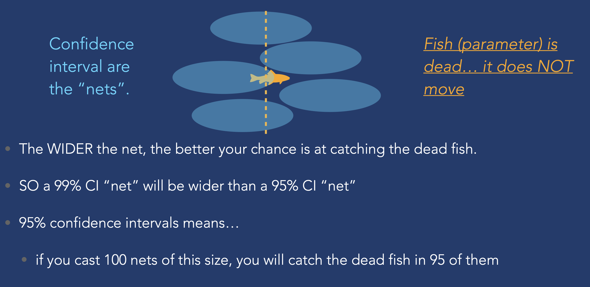

---
format:
  revealjs:
    theme: [default, custom.scss]
    background-color: "#1e3a5f"
    slide-number: false
    controls: true
    progress: false
    transition: fade
    width: 1400
    height: 787
---

```{r}
#| include: false
library(ggplot2)

theme_section <- function() {
  theme_minimal(base_size = 18) +
  theme(
    plot.background  = element_rect(fill = "#1e3a5f", color = NA),
    panel.background = element_rect(fill = "#1e3a5f", color = NA),
    panel.grid.major = element_line(color = "#ffffff22"),
    panel.grid.minor = element_blank(),
    text             = element_text(color = "white"),
    axis.text        = element_text(color = "#cccccc"),
    plot.title       = element_text(color = "#E5A823", size = 20, face = "bold")
  )
}

# helper: normal curve with shaded region
shade_normal <- function(mu, sigma, shade_from, shade_to,
                         title = "", xlab = "",
                         shade_col = "#5BC8DB55",
                         line_col = "#5BC8DB",
                         xlim_low = mu - 3.5 * sigma,
                         xlim_high = mu + 3.5 * sigma) {
  x_all <- seq(xlim_low, xlim_high, length.out = 400)
  y_all <- dnorm(x_all, mu, sigma)
  x_shade <- seq(max(shade_from, xlim_low), min(shade_to, xlim_high), length.out = 400)
  y_shade <- dnorm(x_shade, mu, sigma)

  gap <- max(y_all) * 0.03
  df_curve <- data.frame(x = x_all, y = y_all)
  df_shade <- data.frame(x = c(x_shade[1], x_shade, x_shade[length(x_shade)]),
                         y = c(gap, y_shade, gap))

  ggplot() +
    geom_polygon(data = df_shade, aes(x, y),
                 fill = shade_col, color = NA) +
    geom_line(data = df_curve, aes(x, y),
              color = line_col, linewidth = 1.5) +
    geom_vline(xintercept = mu, color = "#E5A823", linewidth = 0.8, linetype = "dashed") +
    labs(title = title, x = xlab, y = "") +
    scale_y_continuous(expand = expansion(mult = c(0.05, 0))) +
    theme_section() +
    theme(axis.text.y = element_blank(),
          axis.ticks.y = element_blank(),
          plot.title = element_text(size = 18))
}
```

## {background-image="photos/IMG_0492.jpeg" background-size="cover" background-opacity="0.65"}

::: {style="position: absolute; top: 8%; left: 5%;"}
[STAT 5 SP 2026]{.teal style="font-size: 0.65em; letter-spacing: 0.2em; text-transform: uppercase; display: block; margin-bottom: 0.4em;"}

[SECTION 6]{style="font-size: 2.2em; font-weight: 300; letter-spacing: 0.08em; color: white;"}
:::

---

## Agenda

:::: {.columns}
::: {.column width="55%"}
- From counts to proportions
- Sampling distributions
- Attendance quiz
- Confidence intervals (preview)
- Worksheet 5
:::
::: {.column width="45%"}
{style="border-radius: 8px; width: 100%; max-height: 480px; object-fit: cover;"}
:::
::::

---

## Where We Are

<br>

::: {style="text-align: center; font-size: 1.15em;"}
~~Normal model~~ → [**sampling distributions**]{.gold} → confidence intervals → hypothesis tests
:::

<br>

Last section: fluency with the [normal model]{.teal} (z-scores, areas, NORMDIST)

<br>

This section: the [**most important concept**]{.gold} of the second half

<br>

::: {style="font-size: 0.85em; color: rgba(255,255,255,0.65);"}
*If you understand sampling distributions, CIs and hypothesis tests follow naturally*
:::

---

## {background-image="photos/halong2.jpeg" background-size="cover" background-opacity="0.55"}

::: {style="position: absolute; top: 8%; left: 5%;"}
[Review]{.teal style="font-size: 0.65em; letter-spacing: 0.2em; text-transform: uppercase; display: block; margin-bottom: 0.4em; border: 1.5px solid #5BC8DB; padding: 0.2em 0.6em; display: inline-block;"}

[FROM COUNTS TO PROPORTIONS]{style="font-size: 2em; font-weight: 300; letter-spacing: 0.08em; color: white;"}
:::

---

## Last Section: Counts

<br>

Section 5: we modeled [counts]{.teal}

<br>

$X$ = number of Democrats in 25 draws → $X \sim \text{Binomial}(25, 0.45)$

<br>

But polls don't report "we found 11 Democrats out of 25"

<br>

They report [**proportions**]{.gold}: "45% of voters support..."

---

## Parameter vs. Statistic

<br>

```{=html}
<div style="display: flex; justify-content: center; margin-bottom: 1.5em;">
  <div style="display: flex; align-items: center; gap: 2em;">
    <div style="background: rgba(91,200,219,0.15); border: 2px solid #5BC8DB; border-radius: 10px; padding: 1em 2em; text-align: center;">
      <div style="color: #E5A823; font-weight: 600; font-size: 1.1em;">Population</div>
      <div style="color: #5BC8DB; font-size: 0.9em; margin-top: 0.3em;">parameter: <em>p</em>, <em>μ</em></div>
    </div>
    <div style="display: flex; flex-direction: column; align-items: center; gap: 0.3em;">
      <svg width="120" height="40"><defs><marker id="arr1" markerWidth="10" markerHeight="7" refX="9" refY="3.5" orient="auto"><polygon points="0 0, 10 3.5, 0 7" fill="#E5A823"></polygon></marker></defs><line x1="10" y1="20" x2="100" y2="20" stroke="#E5A823" stroke-width="2.5" marker-end="url(#arr1)"></line></svg>
      <span style="color: #E5A823; font-size: 0.7em;">sample</span>
    </div>
    <div style="background: rgba(255,255,255,0.08); border: 2px solid rgba(255,255,255,0.3); border-radius: 10px; padding: 1em 2em; text-align: center;">
      <div style="color: #E5A823; font-weight: 600; font-size: 1.1em;">Sample</div>
      <div style="color: rgba(255,255,255,0.75); font-size: 0.9em; margin-top: 0.3em;">statistic: <em>p̂</em>, <em>x̄</em></div>
    </div>
  </div>
</div>
```

:::: {.columns}
::: {.column width="50%"}
[Parameter]{.gold style="font-weight: 600;"}

- Describes the [**population**]{.teal}
- Fixed, usually unknown

*"The true proportion of all voters who are Democrats"*
:::
::: {.column width="50%"}
[Statistic]{.gold style="font-weight: 600;"}

- Describes a [**sample**]{.teal}
- Varies from sample to sample

*"The proportion of Democrats in our poll of 100"*
:::
::::

---

## The Proportion

<br>

$$\hat{p} = \frac{X}{n} = \frac{\text{count of successes}}{\text{sample size}}$$

<br>

:::: {.columns}
::: {.column width="50%"}
[Example:]{.gold style="font-weight: 600;"}

Poll 100 voters, 47 say Democrat

$\hat{p} = 47/100 = 0.47$
:::
::: {.column width="50%"}
But the [true proportion]{.teal} of Democrats in the population is $p = 0.45$

<br>

$\hat{p} \neq p$ ... and that's expected
:::
::::

---

## {background-image="photos/halong1.jpeg" background-size="cover" background-opacity="0.55"}

::: {style="position: absolute; top: 8%; left: 5%;"}
[The Key Idea]{.teal style="font-size: 0.65em; letter-spacing: 0.2em; text-transform: uppercase; display: block; margin-bottom: 0.4em; border: 1.5px solid #5BC8DB; padding: 0.2em 0.6em; display: inline-block;"}

[SAMPLING DISTRIBUTIONS]{style="font-size: 2em; font-weight: 300; letter-spacing: 0.08em; color: white;"}
:::

---

## $\hat{p}$ Varies

<br>

True proportion of Democrats: $p = 0.45$. Poll $n = 100$ voters [from the same population]{.teal} each time:

<br>

| Poll | 1 | 2 | 3 | 4 | 5 | 6 |
|:---:|:---:|:---:|:---:|:---:|:---:|:---:|
| $\hat{p}$ | 0.47 | 0.43 | 0.46 | 0.44 | 0.49 | 0.42 |

<br>

Same population, same sample size — but every sample gives a [different]{.teal} $\hat{p}$

<br>

This isn't error — it's [**sampling variability**]{.gold}

---

## What If We Could See All Possible Samples?

```{r}
#| echo: false
#| fig-width: 10
#| fig-height: 5
#| fig-align: center
set.seed(42)
phats <- replicate(1000, mean(rbinom(100, 1, 0.45)))
df_sim <- data.frame(phat = phats)

ggplot(df_sim, aes(x = phat)) +
  geom_histogram(aes(y = after_stat(density)),
                 binwidth = 0.02, fill = "#5BC8DB55",
                 color = "#5BC8DB", linewidth = 0.3) +
  geom_vline(xintercept = 0.45, color = "#E5A823",
             linewidth = 1.5, linetype = "dashed") +
  annotate("text", x = 0.45, y = -0.3, label = "p = 0.45",
           color = "#E5A823", size = 6, fontface = "bold") +
  labs(title = "1,000 simulated polls (n = 100 each, same population)",
       x = expression(hat(p)), y = "") +
  theme_section() +
  theme(axis.text.y = element_blank(),
        axis.ticks.y = element_blank())
```

::: {style="text-align: center; font-size: 0.95em;"}
Notice anything familiar about the [shape]{.gold} of this distribution?
:::

---

## Why Normal? The Central Limit Theorem

<br>

The [**Central Limit Theorem (CLT)**]{.gold} says:

<br>

"When you average (or take proportions from) many independent observations, the result tends toward a [**normal distribution**]{.teal}"

<br>

This is [huge]{.gold}: it means we can use [everything we learned about the normal model]{.teal} to reason about $\hat{p}$, the sampling proportion, which is random

---

## Sampling Distribution of $\hat{p}$

<br>

If we take many random samples of size $n$ from a population with proportion $p$:

<br>

[Center:]{.gold style="font-weight: 600;"} $\quad \mu_{\hat{p}} = p$ — centered at the truth

<br>

[Spread:]{.gold style="font-weight: 600;"} $\quad \sigma_{\hat{p}} = \sqrt{\dfrac{p(1-p)}{n}}$ — the [**standard error**]{.teal}

<br>

[Shape:]{.gold style="font-weight: 600;"} $\quad$ approximately [**Normal**]{.teal} when $np \geq 10$ and $n(1-p) \geq 10$

---

## Putting It All Together

<br>

If the conditions are met:

<br>

$$\hat{p} \sim N\!\left(p, \;\sqrt{\frac{p(1-p)}{n}}\right)$$

<br>

$\hat{p}$ follows a [**normal distribution**]{.teal} centered at $p$ with standard deviation $= SE$

<br>

::: {style="font-size: 0.85em; color: rgba(255,255,255,0.65);"}
*This is the CLT in action — and it's why z-scores work for $\hat{p}$*
:::

---

## Standard Error

<br>

$$\sigma_{\hat{p}} = \sqrt{\frac{p(1-p)}{n}}$$

<br>

[Concrete example:]{.gold style="font-weight: 600;"} $p = 0.45$, $n = 100$

$$\sigma_{\hat{p}} = \sqrt{\frac{0.45 \times 0.55}{100}} = \sqrt{0.002475} \approx 0.050$$

<br>

"Most polls of 100 voters will land within [~5 percentage points]{.teal} of the truth"

<br>

::: {style="font-size: 0.85em; color: rgba(255,255,255,0.65);"}
*Empirical rule: ~95% of $\hat{p}$'s fall within $p \pm 2 \times SE = 0.45 \pm 0.10$*
:::

---

## Bigger $n$ = More Precise

```{r}
#| echo: false
#| fig-width: 12
#| fig-height: 4.5
#| fig-align: center
set.seed(42)
df_n <- data.frame(
  phat = c(replicate(1000, mean(rbinom(50, 1, 0.45))),
           replicate(1000, mean(rbinom(500, 1, 0.45)))),
  n = rep(c("n = 50", "n = 500"), each = 1000)
)
df_n$n <- factor(df_n$n, levels = c("n = 50", "n = 500"))

ggplot(df_n, aes(x = phat)) +
  geom_histogram(aes(y = after_stat(density)),
                 binwidth = 0.015, fill = "#5BC8DB55",
                 color = "#5BC8DB", linewidth = 0.3) +
  geom_vline(xintercept = 0.45, color = "#E5A823",
             linewidth = 1.2, linetype = "dashed") +
  facet_wrap(~n) +
  labs(x = expression(hat(p)), y = "",
       title = "Same true proportion (p = 0.45), different sample sizes") +
  theme_section() +
  theme(axis.text.y = element_blank(),
        axis.ticks.y = element_blank(),
        strip.text = element_text(color = "#E5A823", size = 16, face = "bold"))
```

::: {style="text-align: center;"}
Larger $n$ → smaller SE → $\hat{p}$ clusters [tighter]{.teal} around $p$
:::

---

## {background-image="photos/IMG_0525.jpeg" background-size="cover" background-opacity="0.55"}

::: {style="position: absolute; top: 8%; left: 5%;"}
[Attendance]{.teal style="font-size: 0.65em; letter-spacing: 0.2em; text-transform: uppercase; display: block; margin-bottom: 0.4em; border: 1.5px solid #5BC8DB; padding: 0.2em 0.6em; display: inline-block;"}

[QUIZ TIME]{style="font-size: 2em; font-weight: 300; letter-spacing: 0.08em; color: white;"}
:::

---

## Attendance Quiz

```{=html}
<div style="display: flex; gap: 2em; align-items: flex-start; height: 85%;">
  <div style="flex: 0 0 60%;">
    <p style="font-size: 0.7em; color: rgba(255,255,255,0.55); margin-bottom: 0.8em;">
      <em>Not graded on correctness — just scan in!</em>
    </p>
    <p style="font-size: 0.78em; margin-bottom: 0.8em;">
      <span style="color: #E5A823; font-weight: 600;">Q1:</span>
      A survey of 500 UCSC students found 38% bike to campus.
      UCSC wants the true proportion of all students who bike.
      Which is the <em>parameter</em>?
      <br>
      &nbsp; (a) 500 &nbsp; (b) 38% &nbsp; (c) the true proportion of all UCSC students who bike &nbsp; (d) the 500 students surveyed
    </p>
    <p style="font-size: 0.78em; margin-bottom: 0.8em;">
      <span style="color: #E5A823; font-weight: 600;">Q2:</span>
      Researchers sampled 50 households and found 20% had water quality issues.
      They want the true percentage for <em>all</em> households.
      Which is the <em>sample statistic</em>?
      <br>
      &nbsp; (a) all households in the county &nbsp; (b) 20% &nbsp; (c) the true percentage &nbsp; (d) 50
    </p>
    <p style="font-size: 0.78em;">
      <span style="color: #E5A823; font-weight: 600;">Q3–Q4:</span>
      Open Worksheet 5 → Problem 3. Do <strong>3(a) and 3(b)</strong> now.
      <br>
      <span style="color: #5BC8DB; font-size: 0.9em;"><em>Hint: use the sampling distribution — what is p? what is n? what goes in the SE?</em></span>
    </p>
  </div>
  <div style="flex: 0 0 36%; text-align: center; padding-top: 0.5em;">
    <p style="font-size: 0.65em; color: rgba(255,255,255,0.75); margin-bottom: 0.5em;">
      Add your course attendance procedure here.
    </p>
  </div>
</div>
```

---

## 3(a) and 3(b): Discussion

<br>

Both problems: $p = 0.123$ (national rate), asking about $P(\hat{p} \leq 0.16)$

<br>

The z-score: $\quad z = \dfrac{\hat{p} - p}{\sqrt{p(1-p)/n}} = \dfrac{0.16 - 0.123}{\sqrt{0.123 \times 0.877 / n}}$

<br>

:::: {.columns}
::: {.column width="50%"}
[3(a):]{.gold style="font-weight: 600;"} $n = 100$

SE $= \sqrt{0.123 \times 0.877 / 100} \approx 0.033$

$z \approx 1.13$
:::
::: {.column width="50%"}
[3(b):]{.gold style="font-weight: 600;"} $n = 200$

SE $= \sqrt{0.123 \times 0.877 / 200} \approx 0.023$

$z \approx 1.59$
:::
::::

<br>

::: {style="text-align: center;"}
Same question, same $p$ — but larger $n$ → [smaller SE]{.gold}
:::

---

## {background-image="photos/IMG_0500.jpeg" background-size="cover" background-opacity="0.55"}

::: {style="position: absolute; top: 8%; left: 5%;"}
[Preview]{.teal style="font-size: 0.65em; letter-spacing: 0.2em; text-transform: uppercase; display: block; margin-bottom: 0.4em; border: 1.5px solid #5BC8DB; padding: 0.2em 0.6em; display: inline-block;"}

[CONFIDENCE INTERVALS]{style="font-size: 2em; font-weight: 300; letter-spacing: 0.08em; color: white;"}
:::

---

## The Problem

<br>

We want to know $p$ (the true population proportion)

<br>

We only have $\hat{p}$ (from one sample)

<br>

$\hat{p}$ is probably [close]{.teal} to $p$... but how close?

<br>

::: {style="font-size: 0.85em; color: rgba(255,255,255,0.65);"}
*The sampling distribution tells us how much $\hat{p}$ typically varies from $p$*
:::

---

## What a Confidence Interval Is

<br>

A [**confidence interval**]{.gold} gives a range of plausible values for $p$

<br>

$$\left(\;\hat{p} - \underbrace{z^* \times SE}_{\text{margin of error}},\quad \hat{p} + \underbrace{z^* \times SE}_{\text{margin of error}}\;\right)$$

<br>

where $SE = \sqrt{\dfrac{\hat{p}(1-\hat{p})}{n}}$

<br>

::: {style="font-size: 0.85em; color: rgba(255,255,255,0.65);"}
*Note: SE uses $\hat{p}$ here because we don't know $p$ — we're trying to estimate it!*
:::

---

## The Critical Value $z^*$

<br>

$z^*$ controls [how confident]{.teal} we want to be

<br>

| Confidence | $\alpha$ | $z^*$ |
|:---:|:---:|:---:|
| 85% | 0.15 | 1.44 |
| 90% | 0.10 | 1.645 |
| 95% | 0.05 | 1.96 |
| 99% | 0.01 | 2.576 |

<br>

Higher confidence → larger $z^*$ → [wider interval]{.gold}

---

## Margin of Error

<br>

$$\text{MoE} = z^* \times SE = z^* \times \sqrt{\frac{\hat{p}(1-\hat{p})}{n}}$$

<br>

MoE gets [**smaller**]{.teal} when:

- $n$ increases (larger sample → more precise)
- Confidence level decreases (narrower net)

<br>

MoE gets [**larger**]{.gold} when:

- $n$ decreases
- Confidence level increases (wider net)

---

## Interpreting a CI: The Dead Fish

{style="width: 100%; border-radius: 8px;"}

---

## Interpreting a CI: Template

<br>

[Template:]{.gold style="font-weight: 600;"} "We are ___% confident that the true proportion of [context] is between [lower] and [upper]."

<br>

[Common mistake:]{.teal style="font-weight: 600;"} "There is a 95% *chance* that $p$ is in this interval."

<br>

The fish doesn't move! The [95%]{.gold} refers to the **procedure**: if you cast 100 nets of this size, ~95 of them catch the fish.

---

## CI on the Worksheet: MOE_PROP

<br>

On the worksheet, use the custom function:

<br>

`=MOE_PROP(alpha, n, p)`

<br>

| Argument | What to enter |
|:---|:---|
| `alpha` | $1 - \text{confidence level}$ (e.g. 0.05 for 95%) |
| `n` | sample size |
| `p` | your $\hat{p}$ from 1B (since true $p$ is unknown) |

<br>

Then: $\quad \text{Lower} = \hat{p} - \text{MoE} \qquad \text{Upper} = \hat{p} + \text{MoE}$

---

## {background-image="photos/IMG_1652.jpeg" background-size="cover" background-opacity="0.55"}

::: {style="position: absolute; top: 8%; left: 5%;"}
[Worksheet 5]{.teal style="font-size: 0.65em; letter-spacing: 0.2em; text-transform: uppercase; display: block; margin-bottom: 0.4em; border: 1.5px solid #5BC8DB; padding: 0.2em 0.6em; display: inline-block;"}

[LET'S GET TO WORK]{style="font-size: 2em; font-weight: 300; letter-spacing: 0.08em; color: white;"}
:::

---

## Look at the Data First!

<br>

[Dataset:]{.gold style="font-weight: 600;"} Taylor Swift songs on Spotify (191 songs = the population)

<br>

[Variable:]{.gold style="font-weight: 600;"} `DS_more_than_0.6` — does the song have danceability > 0.6?

- 1 = yes, 0 = no

<br>

[Your task:]{.gold style="font-weight: 600;"} Sample 20 songs, use that sample to estimate the true proportion of danceable songs

---

## Worksheet Tips

<br>

[Sampler (P1A):]{.gold style="font-weight: 600;"} Go to the sampling tab → set sample size to [**20**]{.teal} → copy the sample → **Paste Special > Values Only** into the worksheet

<br>

[P1C:]{.gold style="font-weight: 600;"} Use `MOE_PROP(alpha, 20, your_phat)` for each confidence level

- 85%: alpha = 0.15 · 90%: alpha = 0.10 · 95%: alpha = 0.05

<br>

[P2D:]{.gold style="font-weight: 600;"} Read the wording [very]{.teal} carefully — is it talking about the right thing?

<br>

[P3:]{.gold style="font-weight: 600;"} You already did 3(a) and 3(b)! 3(c): why were your answers different?
