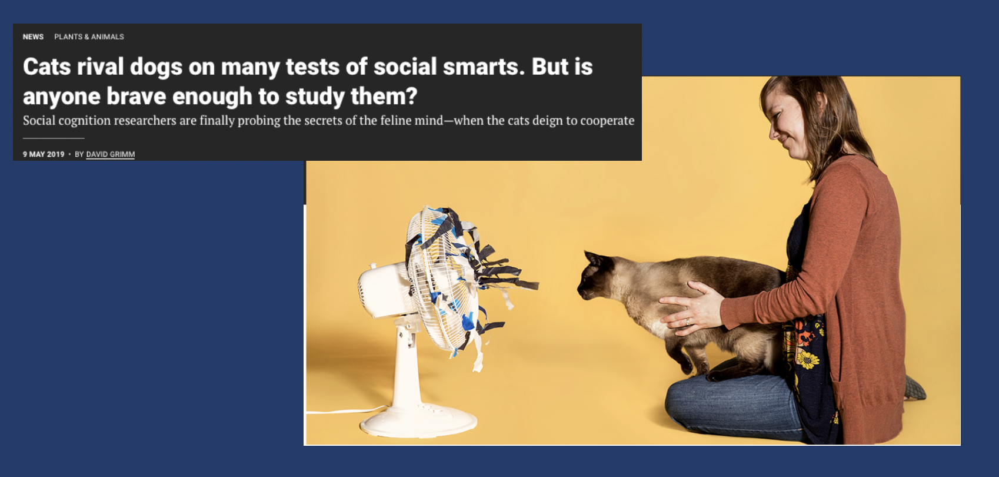
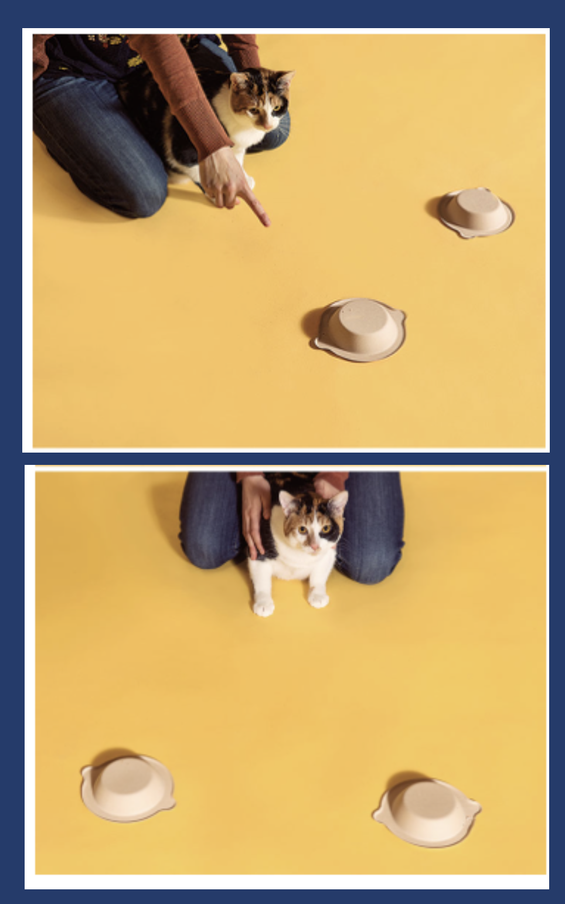

---
format:
  revealjs:
    theme: [default, custom.scss]
    background-color: "#1e3a5f"
    slide-number: false
    controls: true
    progress: false
    transition: fade
    width: 1400
    height: 787
---

```{r}
#| include: false
library(ggplot2)

theme_section <- function() {
  theme_minimal(base_size = 18) +
  theme(
    plot.background  = element_rect(fill = "#1e3a5f", color = NA),
    panel.background = element_rect(fill = "#1e3a5f", color = NA),
    panel.grid.major = element_line(color = "#ffffff22"),
    panel.grid.minor = element_blank(),
    text             = element_text(color = "white"),
    axis.text        = element_text(color = "#cccccc"),
    plot.title       = element_text(color = "#E5A823", size = 20, face = "bold")
  )
}

# helper: normal curve with shaded region
shade_normal <- function(mu, sigma, shade_from, shade_to,
                         title = "", xlab = "",
                         shade_col = "#5BC8DB55",
                         line_col = "#5BC8DB",
                         xlim_low = mu - 3.5 * sigma,
                         xlim_high = mu + 3.5 * sigma) {
  x_all <- seq(xlim_low, xlim_high, length.out = 400)
  y_all <- dnorm(x_all, mu, sigma)
  x_shade <- seq(max(shade_from, xlim_low), min(shade_to, xlim_high), length.out = 400)
  y_shade <- dnorm(x_shade, mu, sigma)

  gap <- max(y_all) * 0.03
  df_curve <- data.frame(x = x_all, y = y_all)
  df_shade <- data.frame(x = c(x_shade[1], x_shade, x_shade[length(x_shade)]),
                         y = c(gap, y_shade, gap))

  ggplot() +
    geom_polygon(data = df_shade, aes(x, y),
                 fill = shade_col, color = NA) +
    geom_line(data = df_curve, aes(x, y),
              color = line_col, linewidth = 1.5) +
    geom_vline(xintercept = mu, color = "#E5A823", linewidth = 0.8, linetype = "dashed") +
    labs(title = title, x = xlab, y = "") +
    scale_y_continuous(expand = expansion(mult = c(0.05, 0))) +
    theme_section() +
    theme(axis.text.y = element_blank(),
          axis.ticks.y = element_blank(),
          plot.title = element_text(size = 18))
}
```

## {background-image="photos/italy1.jpeg" background-size="cover" background-opacity="0.65"}

::: {style="position: absolute; top: 8%; left: 5%;"}
[STAT 5 SP 2026]{.teal style="font-size: 0.65em; letter-spacing: 0.2em; text-transform: uppercase; display: block; margin-bottom: 0.4em;"}

[SECTION 7]{style="font-size: 2.2em; font-weight: 300; letter-spacing: 0.08em; color: white;"}
:::

---

## Agenda

:::: {.columns}
::: {.column width="55%"}
- Quiz (15 min)
- Quiz Review (15 min)
- Hypothesis Testing (20 min)
- Worksheet 6 (15 min)
:::
::: {.column width="45%"}
{style="border-radius: 8px; width: 100%; max-height: 480px; object-fit: cover;"}
:::
::::

---

## {background-image="photos/italy2.jpeg" background-size="cover" background-opacity="0.55"}

::: {style="position: absolute; top: 8%; left: 5%;"}
[15 minutes]{.teal style="font-size: 0.65em; letter-spacing: 0.2em; text-transform: uppercase; display: block; margin-bottom: 0.4em; border: 1.5px solid #5BC8DB; padding: 0.2em 0.6em; display: inline-block;"}

[QUIZ TIME]{style="font-size: 2em; font-weight: 300; letter-spacing: 0.08em; color: white;"}
:::

---

## {background-image="photos/italy5.jpeg" background-size="cover" background-opacity="0.55"}

::: {style="position: absolute; top: 8%; left: 5%;"}
[On the board]{.teal style="font-size: 0.65em; letter-spacing: 0.2em; text-transform: uppercase; display: block; margin-bottom: 0.4em; border: 1.5px solid #5BC8DB; padding: 0.2em 0.6em; display: inline-block;"}

[QUIZ REVIEW]{style="font-size: 2em; font-weight: 300; letter-spacing: 0.08em; color: white;"}

[Q3, Q4, Q5 --- let's work through these on the board]{style="font-size: 0.85em; color: rgba(255,255,255,0.75); display: block; margin-top: 0.6em;"}
:::

---

## Attendance

```{=html}
<div style="display: flex; gap: 2em; align-items: flex-start; height: 85%;">
  <div style="flex: 0 0 55%;">
    <p style="font-size: 0.75em; color: rgba(255,255,255,0.55); margin-bottom: 1em;">
      <em>Add your course attendance procedure here.</em>
    </p>
    <p style="font-size: 0.85em; margin-bottom: 1.5em;">
      <span style="color: #E5A823; font-weight: 600;">Quiz solutions:</span><br>
      Add a course-accessible solution link if appropriate.
    </p>
    <p style="font-size: 0.8em; color: rgba(255,255,255,0.65);">
      Check your work on Q1 & Q2 using the solutions. We reviewed Q3–Q5 on the board.
    </p>
  </div>
  <div style="flex: 0 0 40%; text-align: center; padding-top: 0.5em;">
  </div>
</div>
```

---

## A Note on the Quiz

<br>

If you felt unsure on some of the problems, that's okay --- but this is [foundational material]{.teal} that builds on itself, so it's worth reviewing now while it's fresh.

<br>

Look through the previous weeks' slides and try re-doing the quiz questions on your own. If you can do them [comfortably without notes]{.gold}, you're in good shape.

---

## {background-image="photos/italy4.jpeg" background-size="cover" background-opacity="0.55"}

::: {style="position: absolute; top: 8%; left: 5%;"}
[New Topic]{.teal style="font-size: 0.65em; letter-spacing: 0.2em; text-transform: uppercase; display: block; margin-bottom: 0.4em; border: 1.5px solid #5BC8DB; padding: 0.2em 0.6em; display: inline-block;"}

[HYPOTHESIS TESTING]{style="font-size: 2em; font-weight: 300; letter-spacing: 0.08em; color: white;"}
:::

---

## Motivating Example: Cat Science

{fig-align="center" style="border-radius: 8px; max-height: 680px;"}

---

## Motivating Example: Cat Science

:::: {.columns}
::: {.column width="40%"}
{style="border-radius: 8px; width: 100%; max-height: 700px; object-fit: contain;"}
:::
::: {.column width="60%"}

- Do cats actually understand people pointing or are they selecting the right bowl based on chance?

<br>

- [Null $H_0$]{.teal}: they choose randomly (selects the right bowl at $p = 50\%$ of the time)

<br>

- [Alternative $H_1$]{.teal}: they do not choose at random — $p \neq 50\%$
:::
::::

---

## The Idea

<br>

[Hypothesis testing:]{.gold style="font-weight: 600;"} you assume something about $p$, then check if your data seems to [contradict]{.teal} your assumption

<br>

Think of it like a trial:

- Start by assuming [**innocent**]{.teal} (= the null hypothesis)
- Look at the evidence (= the data)
- Only convict (= reject) if evidence is [**overwhelming**]{.gold}

<br>

::: {style="font-size: 0.85em; color: rgba(255,255,255,0.65);"}
*This looks more complex than it is — once you do it a couple times, it clicks*
:::

---

## $H_0$ and $H_1$

<br>

:::: {.columns}
::: {.column width="50%"}
[Null hypothesis $H_0$]{.gold style="font-weight: 600;"}

- The "status quo" or "nothing special"
- Always uses [**=**]{.teal}

*"Cats are just guessing"*

$$H_0: p = 0.50$$
:::
::: {.column width="50%"}
[Alternative hypothesis $H_1$]{.gold style="font-weight: 600;"}

- The research question
- Uses $\neq$, $>$, or $<$

*"Cats don't choose at random"*

$$H_1: p \neq 0.50$$
:::
::::

<br>

::: {style="font-size: 0.85em; color: rgba(255,255,255,0.65);"}
*Left-tailed ($<$), right-tailed ($>$), or two-tailed ($\neq$) — depends on the research question*
:::

---

## $p_0$: The Hypothesized Proportion

<br>

$p_0$ is the value of $p$ specified in $H_0$ --- what we [assume]{.teal} to be true, then test against

<br>

[Cat example:]{.gold style="font-weight: 600;"}

*"Cats are just guessing"* → $H_0: p = \color{#5BC8DB}{0.50}$ → so $\color{#5BC8DB}{p_0} = \color{#5BC8DB}{0.50}$

---

## Test Statistic

<br>

$$Z = \frac{\hat{p} - p_0}{\underbrace{\sqrt{\dfrac{p_0(1-p_0)}{n}}}_{\text{SE (uses } p_0 \text{)}}}$$

<br>

This is just a [**z-score**]{.gold}! Same idea as quiz Q3:

<br>

"How many standard errors is $\hat{p}$ from $p_0$?"

<br>

::: {style="font-size: 0.85em; color: rgba(255,255,255,0.65);"}
*SE uses $p_0$ because we assume $H_0$ is true*
:::

---

## Which $p$ Goes in the SE?

<br>

The SE formula $\sqrt{\dfrac{p(1-p)}{n}}$ always has the same structure --- but [which $p$]{.gold} you plug in depends on the context:

<br>

| Context | SE uses... | Why? |
|:---|:---:|:---|
| Sampling distribution | $p$ | We [know]{.teal} the true proportion |
| Confidence interval | $\hat{p}$ | We're [estimating]{.teal} — don't know $p$ |
| Hypothesis test | $p_0$ | We [assume]{.teal} $H_0$ is true |

<br>

::: {style="font-size: 0.85em; color: rgba(255,255,255,0.65);"}
*Q3 on your quiz used $p$. Q5 used $\hat{p}$. The hypothesis test uses $p_0$.*
:::

---

## P-value

<br>

In general, the p-value is the probability that you see data [as or more extreme]{.teal} than what you observed, if $H_0$ were true.

<br>

Small p-value → data [contradicts]{.gold} $H_0$ → evidence to reject

<br>

What "extreme" means depends on the direction of $H_1$...

---

## P-value: Left-Tailed ($H_1: p < p_0$)

The probability of seeing something [smaller]{.teal} than what you observed.

```{r}
#| echo: false
#| fig-width: 9
#| fig-height: 4
#| fig-align: center
shade_normal(0, 1, -4, -1.5,
             title = "",
             xlab = "Z") +
  annotate("text", x = -2.2, y = 0.06, label = "p-value",
           color = "#E5A823", size = 6, fontface = "bold") +
  annotate("segment", x = -1.5, xend = -1.5, y = 0, yend = dnorm(-1.5),
           color = "#E5A823", linewidth = 1, linetype = "dashed") +
  annotate("text", x = -1.5, y = -0.025, label = "Z",
           color = "#E5A823", size = 5)
```

---

## P-value: Right-Tailed ($H_1: p > p_0$)

The probability of seeing something [larger]{.teal} than what you observed.

```{r}
#| echo: false
#| fig-width: 9
#| fig-height: 4
#| fig-align: center
shade_normal(0, 1, 1.5, 4,
             title = "",
             xlab = "Z") +
  annotate("text", x = 2.2, y = 0.06, label = "p-value",
           color = "#E5A823", size = 6, fontface = "bold") +
  annotate("segment", x = 1.5, xend = 1.5, y = 0, yend = dnorm(1.5),
           color = "#E5A823", linewidth = 1, linetype = "dashed") +
  annotate("text", x = 1.5, y = -0.025, label = "Z",
           color = "#E5A823", size = 5)
```

---

## P-value: Two-Tailed ($H_1: p \neq p_0$)

The probability of seeing something [this far from $p_0$ in either direction]{.teal}.

```{r}
#| echo: false
#| fig-width: 9
#| fig-height: 4
#| fig-align: center
shade_normal(0, 1, 1.5, 4, title = "", xlab = "Z") +
  geom_polygon(
    data = data.frame(
      x = c(-3.5, seq(-3.5, -1.5, length.out = 200), -1.5),
      y = c(dnorm(0) * 0.03, dnorm(seq(-3.5, -1.5, length.out = 200)), dnorm(0) * 0.03)
    ),
    aes(x, y), fill = "#5BC8DB55"
  ) +
  annotate("text", x = -2.2, y = 0.06, label = "p/2",
           color = "#E5A823", size = 5, fontface = "bold") +
  annotate("text", x = 2.2, y = 0.06, label = "p/2",
           color = "#E5A823", size = 5, fontface = "bold") +
  annotate("segment", x = -1.5, xend = -1.5, y = 0, yend = dnorm(-1.5),
           color = "#E5A823", linewidth = 1, linetype = "dashed") +
  annotate("segment", x = 1.5, xend = 1.5, y = 0, yend = dnorm(1.5),
           color = "#E5A823", linewidth = 1, linetype = "dashed") +
  annotate("text", x = -1.5, y = -0.025, label = "-|Z|",
           color = "#E5A823", size = 5) +
  annotate("text", x = 1.5, y = -0.025, label = "|Z|",
           color = "#E5A823", size = 5)
```

---

## Decision

<br>

Compare the p-value to your significance level $\alpha$:

<br>

```{=html}
<div style="display: flex; gap: 2em; justify-content: center;">
  <div style="background: rgba(229,168,35,0.15); border: 2px solid #E5A823; border-radius: 10px; padding: 1.2em 2em; text-align: center; flex: 0 0 40%;">
    <div style="color: #E5A823; font-weight: 600; font-size: 1.1em; margin-bottom: 0.5em;">p-value ≤ α</div>
    <div style="color: white; font-size: 1em;">Reject H₀</div>
    <div style="color: rgba(255,255,255,0.6); font-size: 0.8em; margin-top: 0.3em;">Evidence is strong enough</div>
  </div>
  <div style="background: rgba(91,200,219,0.15); border: 2px solid #5BC8DB; border-radius: 10px; padding: 1.2em 2em; text-align: center; flex: 0 0 40%;">
    <div style="color: #5BC8DB; font-weight: 600; font-size: 1.1em; margin-bottom: 0.5em;">p-value > α</div>
    <div style="color: white; font-size: 1em;">Do Not Reject H₀</div>
    <div style="color: rgba(255,255,255,0.6); font-size: 0.8em; margin-top: 0.3em;">Not enough evidence</div>
  </div>
</div>
```

<br>

::: {style="text-align: center;"}
"Do Not Reject" $\neq$ "accept" — just like [not guilty]{.teal} $\neq$ innocent
:::

---

## {background-image="photos/italy3.jpeg" background-size="cover" background-opacity="0.55"}

::: {style="position: absolute; top: 8%; left: 5%;"}
[Worksheet 6]{.teal style="font-size: 0.65em; letter-spacing: 0.2em; text-transform: uppercase; display: block; margin-bottom: 0.4em; border: 1.5px solid #5BC8DB; padding: 0.2em 0.6em; display: inline-block;"}

[LET'S GET TO WORK]{style="font-size: 2em; font-weight: 300; letter-spacing: 0.08em; color: white;"}
:::

---

## Look at the Data First!

<br>

[Question:]{.gold style="font-weight: 600;"} Is Congress too old?

<br>

[Data:]{.gold style="font-weight: 600;"} 118th US Congress members, variable `older_than_65` (1 = yes, 0 = no)

<br>

[Background:]{.gold style="font-weight: 600;"} According to the US Census, 16.8% of Americans are 65+.

<br>

Open the worksheet and read the background section carefully. Your first task is to set up $H_0$ and $H_1$.

---

## The PVAL Function

<br>

The worksheet has a custom function to compute p-values:

<br>

`=PVAL(z, alternate)`

<br>

| Argument | What to enter |
|:---|:---|
| `z` | your test statistic $Z$ |
| `alternate` | `"two-sided"`, `"greater than"`, or `"less than"` |

<br>

::: {style="font-size: 0.85em; color: rgba(255,255,255,0.65);"}
*Think about which alternate matches your $H_1$ before plugging in*
:::
